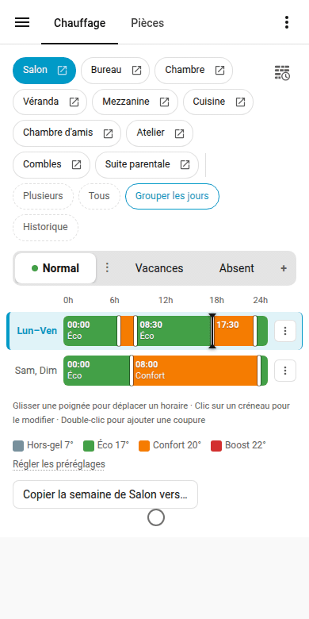
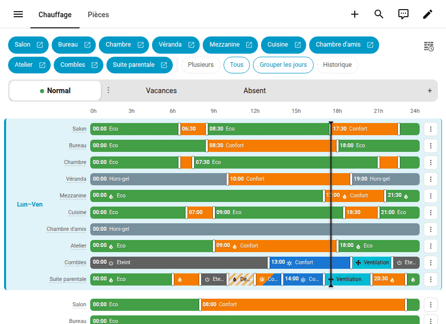

# ha-chauffage

[English](README.md) · **Français**

Chauffage programme vos thermostats Home Assistant semaine par semaine, comme un thermostat
programmable, et réunit toute la maison sur une seule carte. Chauffage fonctionne avec les
thermostats sans préréglages, avec préréglages,
**[Versatile Thermostat](https://github.com/jmcollin78/versatile_thermostat)** et les
climatisations. Vous réglez tout depuis l'interface de Home Assistant, sans YAML.

ha-chauffage est un projet indépendant, sans lien avec Versatile Thermostat.

## Une semaine par pièce, un planning pour chaque situation

Vous dessinez la semaine de chaque pièce sur la carte. Faites glisser les créneaux, copiez une
journée, ou modifiez d'un coup les jours identiques. Chaque créneau demande un préréglage, par
exemple *Confort* ou *Éco*. La carte marche aussi sur téléphone.

Un **planning** contient les semaines de toutes les pièces. Créez autant de plannings que votre
vie en demande, par exemple *Normal*, *Télétravail* ou *Vacances*, et activez-en un d'un geste.
Chauffage peut aussi changer de planning pour vous, par exemple selon la couleur Tempo d'EDF du
jour ou selon un calendrier.

Activez *Historique*, et la carte montre sous chaque semaine la température de la pièce sur les
7 derniers jours. Vous vérifiez ainsi d'un coup d'œil que la pièce a suivi son planning.

Voir [Plannings](docs/schedules.fr.md) et [Règles d'activation](docs/activation-rules.fr.md).

## Un changement à la main, puis le planning reprend tout seul

Quand vous tournez la molette, Chauffage garde votre consigne 2 heures. Ensuite, le thermostat
reprend son planning. Vous montez le salon à 22 °C à 21 h 30 ? Le salon reprend son planning à
23 h 30. Vous pouvez modifier l'heure à laquelle se terminera la dérogation. Par exemple, elle
peut s'arrêter au prochain créneau, comme sur un thermostat classique.

La carte vous dit ce que fait chaque thermostat, pourquoi, et jusqu'à quand. Ajoutez une carte
par pièce à votre tableau de bord. Depuis cette carte, vous prolongez une dérogation d'un geste,
y compris sur votre téléphone.

Voir [Dérogations](docs/overrides.fr.md).

## Un panneau pour les gouverner tous

Les administrateurs trouvent *Chauffage* dans la barre latérale. Le panneau rassemble les
plannings et leurs règles d'activation, les thermostats et les préréglages.

**Préréglages.** Un préréglage veut dire la même chose dans chaque pièce, et chaque thermostat
l'applique à sa façon. Sur un Versatile Thermostat, *Confort* utilise son propre préréglage *comfort*.
Sur un thermostat simple, *Confort* envoie 20 °C. Voir [Préréglages](docs/presets.fr.md).

**Climatisations.** Sur une climatisation, un créneau choisit aussi ce que fait l'appareil, par
exemple refroidir ou seulement ventiler. Voir [Climatisations](docs/air-conditioners.fr.md).

**Qui peut modifier quoi.** Vous choisissez ce que les autres utilisateurs peuvent modifier. Par
exemple, votre famille peut créer des dérogations et changer de planning, mais pas modifier les
semaines. Voir [Qui peut modifier quoi](docs/panel.fr.md#qui-peut-modifier-quoi).

## Vos thermostats, vos automatisations

Chauffage fonctionne avec toute entité `climate` qui a une température de consigne. Vérifiez
votre thermostat dans [Thermostats compatibles](docs/thermostats.fr.md).

Chauffage vous donne des entités, des services et des événements. Par exemple, vous pouvez
activer le planning *Vacances* quand vous partez, ou recevoir une notification quand quelqu'un
change un thermostat à la main. Voir
[Entités, services et événements](docs/automations.fr.md).

## Installation

Nécessite Home Assistant 2025.1 ou plus récent.

Installez ha-chauffage depuis HACS, puis ajoutez l'intégration **Chauffage**. Ensuite, dans le
panneau Chauffage, cochez les thermostats que Chauffage pilote.
[Installation](docs/installation.fr.md) donne toutes les étapes, les cartes à ajouter, et
comment mettre à jour.

## En savoir plus

- **Un thermostat a fait autre chose que prévu ?** Lisez le [Dépannage](docs/troubleshooting.fr.md).
- **La suite** est dans la [feuille de route](ROADMAP.fr.md). Le
  [journal des modifications](CHANGELOG.md), en anglais, dit ce qui a changé à chaque version.
- **Pour contribuer**, lisez [CONTRIBUTING.fr.md](CONTRIBUTING.fr.md).

### Documentation

| Page | Lisez-la pour… |
|---|---|
| [Installation](docs/installation.fr.md) | installer Chauffage, configurer les cartes, mettre à jour, ou migrer depuis le package v0.1 |
| [Thermostats compatibles](docs/thermostats.fr.md) | vérifier que votre thermostat marche avec Chauffage |
| [Le panneau Chauffage](docs/panel.fr.md) | configurer Chauffage, choisir qui peut modifier quoi, suspendre un thermostat, et changer les options |
| [Plannings](docs/schedules.fr.md) | créer des plannings, modifier une semaine, lire l'historique, et changer de planning actif |
| [Règles d'activation](docs/activation-rules.fr.md) | changer de planning automatiquement, par exemple avec Tempo d'EDF ou un calendrier |
| [Préréglages](docs/presets.fr.md) | régler ce que veut dire *Confort* ou *Éco* sur chaque thermostat |
| [Climatisations](docs/air-conditioners.fr.md) | choisir ce que fait l'appareil dans un créneau : chauffer, refroidir, déshumidifier ou ventiler |
| [Dérogations](docs/overrides.fr.md) | choisir combien de temps dure un changement à la main, et créer ou arrêter une dérogation |
| [Entités, services et événements](docs/automations.fr.md) | utiliser Chauffage dans vos automatisations, scripts et tableaux de bord |
| [Dépannage](docs/troubleshooting.fr.md) | comprendre pourquoi un thermostat a fait quelque chose |
| [Outils de préchauffage](docs/preheating.fr.md) | créer un outil qui préchauffe une pièce avant un créneau |
| [Comment ça marche](docs/how-it-works.fr.md) | savoir comment Chauffage stocke ses données et pilote les thermostats |

## Licence

[MIT](LICENSE) © 2026 Armel Larcier

## Sections déplacées

Ce README contenait toute la documentation. Un lien vers l'une de ses anciennes sections arrive
ici. La table donne la page qui contient maintenant la section.

| Section | Maintenant dans |
|---|---|
| Le panneau Chauffage | [panel.fr.md](docs/panel.fr.md) |
| Qui peut modifier quoi | [panel.fr.md](docs/panel.fr.md#qui-peut-modifier-quoi) |
| Étapes d'installation | [installation.fr.md](docs/installation.fr.md) |
| Mettre à jour | [installation.fr.md](docs/installation.fr.md#mettre-%C3%A0-jour) |
| Mise à jour depuis le package (v0.1) | [installation.fr.md](docs/installation.fr.md#mise-%C3%A0-jour-depuis-le-package-v01) |
| Plannings | [schedules.fr.md](docs/schedules.fr.md) |
| Le mode HVAC d'abord : les climatisations | [air-conditioners.fr.md](docs/air-conditioners.fr.md) |
| Changer de planning actif | [schedules.fr.md](docs/schedules.fr.md#changer-de-planning-actif) |
| Règles d'activation | [activation-rules.fr.md](docs/activation-rules.fr.md) |
| Préréglages | [presets.fr.md](docs/presets.fr.md) |
| Thermostats compatibles | [thermostats.fr.md](docs/thermostats.fr.md) |
| Dérogations | [overrides.fr.md](docs/overrides.fr.md) |
| Thermostats programmés | [panel.fr.md](docs/panel.fr.md#thermostats-programm%C3%A9s) |
| Entités | [automations.fr.md](docs/automations.fr.md#entit%C3%A9s) |
| Services | [automations.fr.md](docs/automations.fr.md#services) |
| Événements | [automations.fr.md](docs/automations.fr.md#%C3%A9v%C3%A9nements) |
| Options | [panel.fr.md](docs/panel.fr.md#options) |
| Dépannage | [troubleshooting.fr.md](docs/troubleshooting.fr.md) |
| Architecture | [how-it-works.fr.md](docs/how-it-works.fr.md) |
| Structure | [CONTRIBUTING.fr.md](CONTRIBUTING.fr.md#structure-du-dépôt) |
