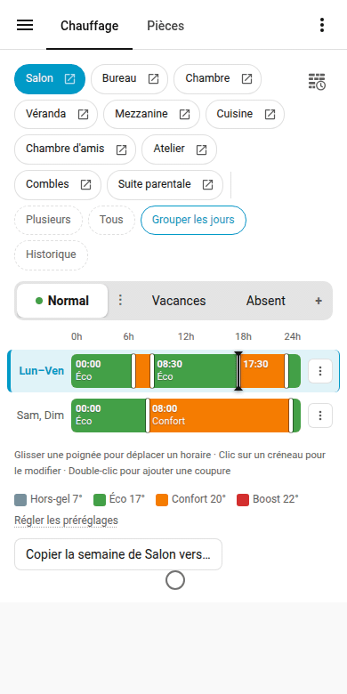
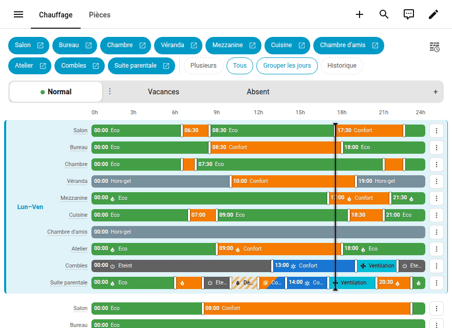

# ha-chauffage

**English** · [Français](README.fr.md)

Chauffage schedules your Home Assistant thermostats week by week, like a programmable
thermostat, and puts the whole house on one card. Chauffage works with thermostats without presets, thermostats
with presets, **[Versatile Thermostat](https://github.com/jmcollin78/versatile_thermostat)** and
air conditioners. You set everything up from the Home Assistant UI, without YAML.

ha-chauffage is an independent project, not affiliated with Versatile Thermostat.

> The project's name is French: *chauffage* means heating.

## A week for each room, a schedule for each situation

You draw the week of each room on the card. Drag the slots, copy a day, or edit identical days
at once. Each slot asks for a preset, for example *Comfort* or *Eco*. The card works on phones
too.

A **schedule** holds the weeks of every room. Create as many schedules as your life needs, for
example *Normal*, *Remote work* or *Holidays*, and activate one with a tap. Chauffage can also
switch the schedule for you, for example from the EDF Tempo color of the day or from a calendar.

Turn on *History*, and under each week the card shows the temperature of the room over the last
7 days. So you check at a glance that the room followed its schedule.

See [Schedules](docs/schedules.md) and [Activation rules](docs/activation-rules.md).

## A change by hand that doesn't last forever

When you turn the dial, Chauffage keeps your setpoint for 2 hours. Then the thermostat goes back
to its schedule. Say you raise the living room to 22 °C at 21:30. The living room goes back to
its schedule at 23:30. You can change when the override ends. For example, it can end at the
next slot, as on a classic thermostat.

The card tells you what each thermostat does, why, and until when. Add a card for each room to
your dashboard. From that card, you give an override more time in one tap, on your phone too.

See [Overrides](docs/overrides.md).

## One panel to set everything up

Administrators find *Chauffage* in the sidebar. The panel holds the schedules and their
activation rules, the thermostats and the presets.

**Presets.** A preset means the same thing in every room, and each thermostat applies it in
its own way. On a
Versatile Thermostat, *Comfort* uses its own *comfort* preset. On a plain thermostat, *Comfort*
sends 20 °C. See [Presets](docs/presets.md).

**Air conditioners.** On an air conditioner, a slot also chooses what the device does, for
example cool or only run the fan. See [Air conditioners](docs/air-conditioners.md).

**Who may change what.** You choose what the other users may change. For example, your family
can start overrides and switch the schedule, but not edit the weeks. See
[Who may change what](docs/panel.md#who-may-change-what).

## Your thermostats, your automations

Chauffage works with any `climate` entity that has a target temperature. Check your thermostat
in [Supported thermostats](docs/thermostats.md).

Chauffage gives you entities, services and events, for example to activate the *Holidays*
schedule when you leave, or to get a notification when someone changes a thermostat by hand.
See [Entities, services and events](docs/automations.md).

## Installation

Requires Home Assistant 2025.1 or later.

Install ha-chauffage from HACS, then add the **Chauffage** integration. Then, in the Chauffage
panel, tick the thermostats that Chauffage controls. [Installation](docs/installation.md) gives
every step, the cards to add, and how to update.

## Learn more

- **A thermostat did something you didn't expect?** Read [Troubleshooting](docs/troubleshooting.md).
- **What comes next** is in the [roadmap](ROADMAP.md). The [changelog](CHANGELOG.md) says what
  changed in each version.
- **To contribute**, read [CONTRIBUTING.md](CONTRIBUTING.md).

### Documentation

| Page | Read it to… |
|---|---|
| [Installation](docs/installation.md) | install Chauffage, set up the cards, update, or upgrade from the v0.1 package |
| [Supported thermostats](docs/thermostats.md) | check that your thermostat works with Chauffage |
| [The Chauffage panel](docs/panel.md) | set Chauffage up, choose who may change what, pause a thermostat, and change the options |
| [Schedules](docs/schedules.md) | create schedules, edit a week, read the history, and change the active schedule |
| [Activation rules](docs/activation-rules.md) | switch the schedule automatically, for example with EDF Tempo or a calendar |
| [Presets](docs/presets.md) | set what *Comfort* or *Eco* means on each thermostat |
| [Air conditioners](docs/air-conditioners.md) | choose what the device does in a slot: heat, cool, dry or fan only |
| [Overrides](docs/overrides.md) | choose how long a change by hand lasts, and start or end an override |
| [Entities, services and events](docs/automations.md) | use Chauffage in your automations, scripts and dashboards |
| [Troubleshooting](docs/troubleshooting.md) | find out why a thermostat did something |
| [Preheating tools](docs/preheating.md) | build a tool that preheats a room before a slot |
| [How it works](docs/how-it-works.md) | learn how Chauffage stores its data and drives the thermostats |

## License

[MIT](LICENSE) © 2026 Armel Larcier

## Moved sections

This README used to hold the whole documentation. A link to one of its old sections lands here.
The table gives the page that holds the section now.

| Section | Now in |
|---|---|
| The Chauffage panel | [panel.md](docs/panel.md) |
| Who may change what | [panel.md](docs/panel.md#who-may-change-what) |
| Installation steps | [installation.md](docs/installation.md) |
| Updating | [installation.md](docs/installation.md#updating) |
| Upgrading from the package (v0.1) | [installation.md](docs/installation.md#upgrading-from-the-package-v01) |
| Schedules | [schedules.md](docs/schedules.md) |
| The HVAC mode first: the air conditioners | [air-conditioners.md](docs/air-conditioners.md) |
| Change the active schedule | [schedules.md](docs/schedules.md#change-the-active-schedule) |
| Activation rules | [activation-rules.md](docs/activation-rules.md) |
| Presets | [presets.md](docs/presets.md) |
| Supported thermostats | [thermostats.md](docs/thermostats.md) |
| Overrides | [overrides.md](docs/overrides.md) |
| Scheduled thermostats | [panel.md](docs/panel.md#scheduled-thermostats) |
| Entities | [automations.md](docs/automations.md#entities) |
| Services | [automations.md](docs/automations.md#services) |
| Events | [automations.md](docs/automations.md#events) |
| Options | [panel.md](docs/panel.md#options) |
| Troubleshooting | [troubleshooting.md](docs/troubleshooting.md) |
| How it works | [how-it-works.md](docs/how-it-works.md) |
| Repository layout | [CONTRIBUTING.md](CONTRIBUTING.md#repository-layout) |
