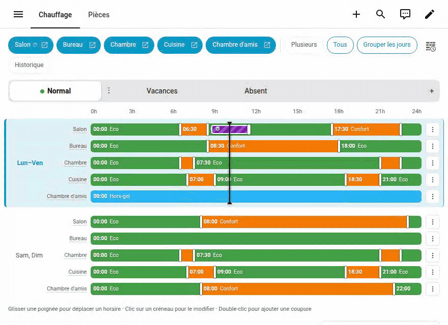

# ha-chauffage

[](https://github.com/armellarcier/ha-chauffage/actions/workflows/tests.yml)


[](https://buymeacoffee.com/TRlbXsQ2yu)

**English** · [Français](README.fr.md)



Chauffage gives your Home Assistant thermostats weekly heating schedules. It works with
thermostats without presets, thermostats with presets, and
**[Versatile Thermostat](https://github.com/jmcollin78/versatile_thermostat)**. ha-chauffage is
an independent project, not affiliated with Versatile Thermostat.

**What happens when you change a setpoint by hand.** Chauffage keeps your setpoint for 2 hours,
then the thermostat goes back to its schedule. Say you raise the living room to 22 °C at 21:30:
the living room goes back to its schedule at 23:30. You can choose another end, for example the
next slot, as on a classic thermostat. [Overrides](#overrides) explains the choices.

- **Schedules.** You create and name as many schedules as you need, for example *Normal*,
  *Remote work* or *Holidays*. Each schedule holds a week for each thermostat. One schedule is
  active at a time, and you can switch it from the card or from an automation.
- **A card to edit the weeks.** You drag the slots, copy and paste days, and edit identical days
  at once. The card also draws the temperature measured over the last 7 days. The card works on
  phones too.
- **A card for each thermostat.** The thermostat card shows what the thermostat does now, why,
  and until when. You can start an override from it.
- **A Chauffage panel to set everything up.** Administrators find *Chauffage* in the sidebar.
  The panel holds the schedules and their activation rules, the thermostats and the presets.
  Each thermostat has its own page there, with its week in every schedule.
- **Overrides.** A setpoint you change by hand is an override: you see it, and change its end, on
  the card. You can also start one from the card, for as long as you need.

> The project's name is French: *chauffage* means heating. The integration and the card speak
> English and French.

## Installation

ha-chauffage is a Home Assistant integration that you set up from the UI. You don't need to edit
any YAML.

Requires Home Assistant 2025.1 or later. We raise the minimum Home Assistant version only when
Chauffage needs a newer Home Assistant API, and the [changelog](CHANGELOG.md) announces it. The
tests run on the minimum version, on one version per quarter since, on the latest release, and
every week on the beta.

### 1. Install the integration from HACS

[](https://my.home-assistant.io/redirect/hacs_repository/?owner=armellarcier&repository=ha-chauffage&category=integration)

The button opens ha-chauffage in the HACS of your Home Assistant. Click *Download*, then restart
Home Assistant.

Without the button, open HACS and search for **ha-chauffage**.

### 2. Add the integration

Go to Settings → Devices & services → *Add integration*, and choose **Chauffage**.

Chauffage then adds a **Chauffage** panel to the sidebar, for administrators. Open it: the
panel welcomes you and lists your thermostats. Tick the ones Chauffage controls, then click
*Schedule*. See [The Chauffage panel](#the-chauffage-panel).

### 3. Add the schedule card

Add the card to a dashboard: *Add card* → **Heating schedules**. The integration serves the card,
so you don't need to add a resource. In the card's visual editor, choose the thermostats and
their names.

You can also write the card in YAML:

```yaml
type: custom:chauffage-programme-card
thermostats:
  - entity: climate.living_room
    name: Living room
```

The card follows your language and your formats, for example the 12 or 24-hour clock. To force
English or French, add `language: en` or `language: fr` to the YAML.

Identical days share a row, for example *Mon–Fri*. Editing the row edits each of its days. To
make one day different, click *Group days*: the card then shows each day on its own row. To show
each day on its own row by default, add `group_days: false` to the YAML.

### 4. Add a card for each room (optional)

The **Scheduled thermostat** card shows one thermostat, for your own dashboards. In *Add card* →
*By entity*, Home Assistant suggests it for each thermostat. In YAML:

```yaml
type: custom:chauffage-thermostat-card
entity: climate.living_room
name: Living room  # optional
```

The card shows the measured temperature and what the thermostat does now, for example
"Normal · Eco until 17:30, then Comfort", and today's slots. From the card, you can start an
override and pause the thermostat. The card also opens the thermostat and its schedule.
Administrators open the thermostat's page in the Chauffage panel.

The thermostat's more-info dialog shows the same information, under the thermostat's controls.
Its link *Edit its week*, or a tap on its week, opens the thermostat's page in the Chauffage
panel, on its week in the active schedule.

## The Chauffage panel

The **Chauffage** panel, in the sidebar, is where an administrator sets Chauffage up. Other users
open it too with the [access level](#who-may-change-what) *Set up*. The
dashboard cards are for every day: they show what the heating does, switch the schedule and
edit the weeks.

To take *Chauffage* out of the sidebar, turn off the option *Show Chauffage in the sidebar* (see
[Options](#options)).

### The panel's pages

The panel has three tabs:

- **Thermostats.** Every scheduled thermostat, and the cards that show it. A thermostat's ⋮ menu
  pauses it or forgets it. You can also schedule another one. Before your first thermostat, this tab
  welcomes you: tick the thermostats Chauffage controls, then *Schedule*.
- **Schedules.** The list of schedules, with the active one marked. A schedule's row opens its
  page, and its ⋮ activates, renames, moves or deletes it. *+ New schedule* creates an empty
  schedule or a copy of another one. The [activation rules](#activation-rules) are below the list.
- **Presets.** The table of the presets: their names, colors and temperatures, and what each one
  does on each thermostat (see [Presets](#presets)).

**Settings.** The ⚙ at the top right of the panel opens the settings: how long an override
lasts (see [Overrides](#overrides)). The settings open in a
dialog, on top of the page you are on. Close the dialog, or press your browser's Back, to
return to that page. At the foot of the dialog, *Other Chauffage options* opens the
integration's page in Home Assistant, where *Configure* holds the other [options](#options).

A schedule or a thermostat opens on a page of its own. The title of the page, for example
"Thermostats › Living room", leads back to its list.

- **A schedule's page** shows every thermostat's week in this schedule. The ⋮ next to the
  page's title renames or deletes the schedule.
- **A thermostat's page** shows the thermostat, whether Chauffage controls it, and its devices.
  Below, its presets serve as the legend of its weeks, one week for each schedule. The ⋮ of a
  week copies it to another schedule. *Group days* groups the identical days of every week, and
  *History* draws the temperature measured over the last 7 days.

### Open a thermostat's page

- From the Chauffage panel, on the *Thermostats* tab, click the thermostat's name.
- From the thermostat's more-info dialog, click *Edit its week*: the page opens on its week in
  the active schedule.
- From the device of the scheduled thermostat, click *Visit*. See
  [On each scheduled thermostat's device](#on-each-scheduled-thermostats-device).

Each page has its own address, for example `/chauffage/thermostats/climate.living_room`. You can
link to a page from a dashboard or a notification.

## Who may change what

In Home Assistant, a user is an administrator or not. Administrators can always change
everything. You choose what the other users may change: their **access level**.

| Access level | What users who are not administrators can do |
|---|---|
| *Use*, the default | Set and end overrides, pause a thermostat, change the active schedule. |
| *Plan* | Also edit the weeks, and create, rename, move or delete schedules, from the dashboard cards. |
| *Set up* | Also everything in the Chauffage panel: the presets, the activation rules, the scheduled thermostats and the settings of overrides. |

To choose the access level, open the Chauffage panel and its ⚙, or the integration's
[options](#options). Only administrators choose the access level.

**With *Set up*, every user sees *Chauffage* in the sidebar.** Home Assistant shows a panel to
every user who may open it. Each user can hide the entry in their profile.

**An access level doesn't lock the heating.** The access level covers the cards and the panel.
Home Assistant still lets every user control the thermostats and the entities of Chauffage, and
call its services. For example, a user with *Use* can still turn a thermostat's knob, or change
*Override duration* from its entity. To keep a child away from the weeks, give the child a
dashboard without the schedule card.

## Updating

Read the [changelog](CHANGELOG.md), then update ha-chauffage from HACS. Chauffage migrates your
stored data automatically. Going back to an older version is not supported.

## Upgrading from the package (v0.1)

Version 0.1 of ha-chauffage was a YAML package. The integration imports the package's data.

1. Install the integration (steps 1 and 2 of the installation). **Don't remove the package
   yet.** The setup offers to import the package's weeks, its current overrides and its active
   schedule. The setup then turns off the package's two automations, so that only the
   integration drives the thermostats.
2. Check the card and the thermostats. To go back to the package, delete the integration and
   turn the two `automation.chauffage_*` automations back on. The import does not change the
   package's data.
3. Follow the repair that Home Assistant shows in Settings. The repair asks you to delete
   `packages/chauffage/` and `www/chauffage/`, to remove the `extra_module_url` line and the
   `recorder` exclusions from `configuration.yaml`, and to restart Home Assistant.
4. In your automations, replace `input_select.mode_chauffage` with `select.chauffage_schedule`.

The package is no longer maintained. If you still want it, the
[v0.1.0 release](https://github.com/armellarcier/ha-chauffage/releases/tag/v0.1.0) holds it, with
its own README.

## Schedules

A **schedule** is a weekly plan, for example *Normal* or *Holidays*. A schedule holds a **week**
for each thermostat. A week is made of **slots**, and each slot asks for a **preset**, for
example *Comfort* or *Eco*. The [glossary](docs/glossary.md) defines these words.

**Who decides what.** A slot says when, and what the room gets: *Off*, *Fan only*, or a preset.
On an air conditioner, the slot also chooses the HVAC mode, *Heat* or *Cool*. The preset says
how warm, for each thermostat, when it heats and when it cools.

### Create a schedule

A new installation starts with one schedule, *Normal*. In the card, **+** creates a schedule:
an empty one, or a copy of another schedule. To rename, move or delete a schedule, open its tab
and use **⋮**. Who may change the schedules depends on the [access level](#who-may-change-what).

Each schedule has a **stable id**, shown in *Rename…*. The stable id never changes, even when
you rename the schedule. Use the stable id in your automations.

### Turn a thermostat off from a slot

A slot is a preset, or *Off*. Open the slot, then tap **Off**, the first chip of the row of
presets. The slot turns grey, named *Off*. Tap a preset to let the thermostat run again.

The thermostat turns off when the slot starts. Chauffage sends it nothing else: if you turn the
thermostat on by hand, it starts again on its own last setpoint. The next slot that asks for a
preset turns it back on, in heat when the thermostat has it.

**Each slot is independent.** A night is two slots: the last slot of a day, and the first slot
of the next day. To keep a room off through the night, turn off both.

**The setpoint of the slot.** The popover says what setpoint the slot will apply on this
thermostat, with its number: "Setpoint: 20 °C (its *Comfort* preset)". An administrator taps
the line to open the *Presets* tab.

### Heat or cool: the air conditioners

On an air conditioner, a slot also chooses the HVAC mode. Open the slot: under the presets, tap
**Heat** or **Cool**. Tap it again to remove the choice. Heaters don't show these buttons.

- **Heat** or **Cool.** The air conditioner switches to this HVAC mode when the slot starts.
- **Neither** (the default). The air conditioner keeps the HVAC mode it has: an air conditioner
  that cools keeps cooling. A thermostat that is off is turned on in heat when it has it.

**Colors.** Each preset has two colors. A slot that cools is drawn in the preset's cool color,
with a snowflake. Chauffage derives the cool color from the preset's color, and you can change
it in the *Presets* tab.

**How warm when cooling.** On an air conditioner that heats and cools, each preset has a value
*when heating* and a temperature *when cooling* (see
[Presets](#what-a-preset-does-on-each-thermostat)). The slot's HVAC mode picks which one
Chauffage sends. Without a temperature when cooling, Chauffage sends the thermostat's own
preset when the preset uses one. Chauffage never sends a heating temperature to an air
conditioner that cools: the slot then says "Setpoint unchanged when cooling".

**Summer and winter.** Create a *Summer* schedule whose slots say *Cool*, as a copy of your
*Winter* schedule. To change season, activate the other schedule: by hand, from an automation,
or with an [activation rule](#activation-rules).

### Fan only

On a thermostat that has a fan-only HVAC mode, the row of presets starts with **Off**, then
**Fan only**. A fan-only slot runs the fan without heating or cooling. It has no preset and no
setpoint. The week shows it in Home Assistant's color of fan only, with a fan.

**Fan and vanes.** On an air conditioner, *More settings* holds the fan speed and the vanes,
one list per setting the thermostat lists. *Don't change* leaves the setting to the preset's
value, or to the thermostat. The folded line shows the values the slot sets, and the week shows
a mark on the slots that set one. An off slot has none.

### Change the active schedule

One schedule is active at a time. The **Active schedule** select (`select.chauffage_schedule`)
shows which one.

- **From the card**, open the schedule's tab, then click *Activate*.
- **From the Chauffage panel**, on the *Schedules* tab, open the schedule's ⋮ menu, then click
  *Activate*.
- **From an automation**, call `chauffage.activate_schedule` with the schedule's stable id. The
  select's `schedule_id` attribute gives the stable id of the active schedule.
- **From a dashboard, a script or by voice**, use the select or the schedule's switch (see
  [Entities](#entities)).

For example, this automation switches between two schedules, on even and odd weeks:

```yaml
triggers:
  - trigger: time
    at: "00:00:00"
conditions:
  - condition: template
    value_template: "{{ now().weekday() == 0 }}"
actions:
  - action: chauffage.activate_schedule
    data:
      schedule: "{{ 'normal' if now().isocalendar().week % 2 == 0 else 'odd_weeks' }}"
```

## Activation rules

Activation rules switch the schedule for you, without an automation. You write the rules in the
Chauffage panel, on the *Schedules* tab, below the schedules. Who may change the rules depends on
the [access level](#who-may-change-what).

### How the rules work

The rules are in order. **The first rule that applies wins.** When no rule applies, Chauffage
activates the default schedule. Without a default schedule, the active schedule stays.

A rule is a template. You can write a rule in two ways:

- **A template and a schedule.** The schedule is active while the template is true. Chauffage
  reads the template as a template condition does: for example `true`, `on`, `yes` or `1` are
  true, and any other text is false.
- **A template that gives the schedule.** The template returns the schedule's name or its stable
  id.

The card tries each rule as you type. For each rule, the card shows what the template gives now
(or its error), and whether the rule applies.

If you choose a schedule by hand, your choice stays until the outcome of the rules changes. The
select's `rules_choice` attribute gives the schedule the rules ask for. To go back to it at
once, an automation can call `chauffage.activate_schedule`.

### Example: EDF Tempo

To follow the EDF Tempo color of the day, write two rules and choose *Normal* as the default
schedule:

| Template | Schedule |
|---|---|
| `{{ is_state('sensor.edf_tempo_color', 'red') }}` | *Away* |
| `{{ is_state('sensor.edf_tempo_color', 'white') }}` | *Eco days* |
| (no rule applies) | *Normal* (default) |

You can also write a single rule whose template gives the schedule:

```jinja
{{ {'red': 'away', 'white': 'eco_days'}.get(states('sensor.edf_tempo_color'), 'normal') }}
```

### Example: a calendar of schedules

#### One rule

You can plan your schedules in a calendar. Chauffage then activates the schedule named by the
current event.

1. Add a *Local Calendar* (Settings › Devices & services › Add integration), for example
   `calendar.chauffage`.
2. Add events named after your schedules. For example: *Holidays* from Friday evening to Sunday,
   *Away* until Tuesday 18:00, and *Remote work* every Wednesday as a recurring event.
3. Write one rule, and choose *Normal* as the default schedule:

   ```jinja
   {{ state_attr('calendar.chauffage', 'message') if is_state('calendar.chauffage', 'on') }}
   ```

While an event runs, the event's title gives the schedule. The title can be the schedule's name,
in any case, or its stable id. Between events, the default schedule applies. A new schedule needs
no change to the rule.

Any calendar works the same way, for example Google or CalDAV. You can then plan from your
phone, or share the calendar with your household.

#### Overlapping events

With the rule above, events must not overlap. A calendar entity shows only one event: the event
that started first. So an *Away* evening during a week of *Holidays* is not seen.

To plan exceptions inside a longer event, use the blueprint
[`calendar_schedule.yaml`](blueprints/automation/chauffage/calendar_schedule.yaml). The blueprint
reads every running event. The blueprint writes the schedule of the event that started last
into a text helper.

1. Create a *Text* helper (Settings › Devices & services › Helpers), for example
   `input_text.calendar_schedule`.
2. [](https://my.home-assistant.io/redirect/blueprint_import/?blueprint_url=https%3A%2F%2Fgithub.com%2Farmellarcier%2Fha-chauffage%2Fblob%2Fmain%2Fblueprints%2Fautomation%2Fchauffage%2Fcalendar_schedule.yaml),
   then create an automation from the blueprint, with your calendar and the helper.
3. Write a rule that reads the helper: `{{ states('input_text.calendar_schedule') }}`.

The blueprint ignores events whose title names no schedule. The schedule changes as soon as an
event starts or ends. The blueprint sees a new or edited event the next time it reads the
calendar: every five minutes by default. For an online calendar, choose fifteen minutes, because
an online calendar only syncs at that pace.

## Presets

Slots ask for presets. Chauffage comes with four presets: *Comfort* 20 °C, *Eco* 17 °C,
*Boost* 21 °C and *Frost protection* 7 °C.

### What a preset does on each thermostat

If the thermostat has its own preset with the same name, Chauffage uses that preset. Otherwise,
Chauffage sets the preset's temperature. You can change this for each thermostat: a preset's
value on a thermostat is one of the thermostat's own presets, or a temperature.

**An air conditioner that heats and cools** has two values for each preset: one *when heating*,
and a temperature *when cooling*. For example, *Comfort* is 20 °C when it heats and 25 °C when
it cools. The slot's HVAC mode picks which one Chauffage sends. Without a temperature when
cooling, Chauffage sends the thermostat's own preset, which the thermostat reads for the HVAC
mode it runs in. A temperature *when heating* is never sent to an air conditioner that cools.

A preset's value can also set the fan and the vanes of an air conditioner.

A preset never turns a thermostat off, and never chooses between heat and cool. To turn every
thermostat off, create a schedule whose slots are *Off*, for example *Away*.

### Set the presets in the Chauffage panel

Open the Chauffage panel, then the *Presets* tab. Who may change the presets depends on the
[access level](#who-may-change-what). The
table has a column for each preset, from the coldest to the warmest, and a row for each
thermostat. A thermostat's page in the panel shows its presets side by side, without the table.

- **A column header** opens the preset: its name, its color and its default temperature. With
  an air conditioner, the preset also has a *Color when cooling*, for its slots that cool.
  Chauffage derives it from the preset's color until you choose one. You can also delete the
  preset from there. To add a preset, click *+ Add a preset* under the table.
- **A cell** opens what the preset does on this thermostat. The cell says where its temperature
  comes from, for example "its *Comfort* preset", "set here" or "default". The popover asks one
  question, with three answers: *Default*, *Its preset* (one of the thermostat's own presets)
  or *Temperature*. On an air conditioner that heats and cools, these answers are the value
  *when heating*, and one more field holds the temperature *when cooling*. *More settings* holds
  the fan and the vanes. *Copy from the thermostat* fills the fields from the thermostat as it
  is now: its setpoint, its fan and its vanes, never its preset. You tap *OK* to keep them. The
  popover also links to the thermostat's device. You set the thermostat's own presets there.

### The temperature of a thermostat's own preset

No standard attribute gives the temperature of a thermostat's own preset. So Chauffage remembers
the setpoint it saw while that preset was active. Until then, the card shows "?".

Versatile Thermostat is an exception. Chauffage reads the temperatures of its presets from its
attributes.

## Supported thermostats

Chauffage works with any `climate` entity that has a target temperature. The tests cover three
kinds of thermostats:

- **Versatile Thermostat.** Chauffage uses its presets (`comfort`, `eco`, `boost`, `frost`). You
  set their temperatures in Versatile Thermostat. If you change the setpoint by hand, Versatile
  Thermostat switches to preset `none`, and Chauffage makes it an override.
- **Thermostats with standard presets**, for example `eco` or `comfort`. Chauffage uses the
  thermostat's preset with the same name. For the other presets, for example frost protection,
  Chauffage sets a temperature.
- **Thermostats without presets**, for example `generic_thermostat`. Chauffage sets
  temperatures. Any setpoint that someone else changes becomes an override.

Chauffage doesn't support these devices yet:

- heat / cool thermostats with a temperature range (`heat_cool`);
- devices that change their setpoint by themselves, because Chauffage could take their changes
  for manual changes.

Some devices keep their preset when you change their setpoint by hand. For such a device, set
every preset to a temperature in the Chauffage panel, on the *Presets* tab.

The [roadmap](ROADMAP.md) says what comes next, for example groups of thermostats.

## Overrides

**Your thermostat went back to its schedule?** You changed its setpoint by hand, and Chauffage
kept your change for a while only. Chauffage calls this temporary change an *override*.

**How long a change by hand lasts.** By default, your change lasts 2 hours, whatever the
schedule. A change by hand is a change on the thermostat, with its knob, or in Home Assistant.
The card says why the override ends then, next to its end: *today, 2 h after the change* or
*today, at the next slot*. An administrator taps these words to open the settings, on top of
the card or of the more-info dialog.

### Choose how long an override lasts

Open the settings: tap the reason of an override's end, or the ⚙ of the Chauffage panel. Under
*Overrides*, set the *Duration*, then choose one of three ends. Take a living room with a comfort
slot until 22:30, and an office whose next slot is at 6:00:

| End of overrides | Your change lasts… | Living room raised at 21:30 | Office raised at 18:30 |
|---|---|---|---|
| **For the override duration** (default) | the override duration, 2 hours by default | until 23:30 | until 20:30 |
| **For the override duration, or less if a slot starts first** | the override duration, or until the next slot if the next slot starts sooner | until 22:30 | until 20:30 |
| **Until the next slot** | until the next slot, however far, as on a classic thermostat | until 22:30 | until 6:00 |

The next slot is the first slot that changes the thermostat's setpoint. A slot that starts less
than 15 minutes after your change does not count, so a change made just before a slot is not
undone at once. With *Until the next slot*, a week on a single preset has no next slot: your
change then lasts a week, unless you end it sooner.

The setting applies to every thermostat. The panel, the [options](#options) and
[entities](#on-the-chauffage-device) change the same settings. For example, an automation can
choose *Until the next slot* during the holidays.

### Keep a change longer

Set the end of the override on the card, or in the thermostat's more-info dialog. For example,
set it to tomorrow 18:00. An end that you choose stays: the next slots don't end the override.

To keep one change until the next slot, whatever the setting, tap the button under the override,
on the card or in the more-info dialog. The button shows the time, for example *Until 17:30 (next
slot)*: it may also shorten the override.

### Start an override

- **On the thermostat.** Change the setpoint or the preset by hand, with the knob or in Home
  Assistant. Chauffage makes your change an override.
- **From the card**, or from the thermostat's more-info dialog. Choose *Off*, a preset or a
  temperature, and an end. Every user can, not only administrators, as with the knob.
  A new override lasts the override duration; *Off* lasts until the next slot, or as the setting
  *When turned off by hand* says. Then you can change its end.
  To turn a thermostat off until the morning, tap *Off*, then *Until tomorrow 06:30*.
  On a thermostat that has a fan-only HVAC mode, *Fan only* is the second chip.
  On a thermostat card, the override shows with its end and *Resume the schedule*. *Change*
  unfolds the rest.
- **From an automation**, with the `chauffage.set_override` action.

A change made by an automation does not start an override: a script that turns every thermostat
off in the evening leaves them off until the morning slot. A command that a battery valve
applies late does not start one either.

### Turn a thermostat off by hand

Turning a thermostat off, with its button or in Home Assistant, is a change like any other:
Chauffage makes it an override, shown as *⏱ Off*. The thermostat stays off until the next slot
that changes it, however far. Then Chauffage turns it back on, on its slot.

**How long a thermostat stays off.** In the settings, under *Overrides*, *When turned off by
hand* has the same three choices as the end of the other overrides. *Until the next slot* is
the default: two hours of off is rarely what you mean when you turn a radiator off. The setting
also applies to *Off* tapped on the card.

To keep it off until the morning, tap *Until tomorrow 06:30* under the override: the button
gives the next morning, the first slot of the day that changes the thermostat's state. When
that morning is not tomorrow, the button names the day, *Until Monday 06:30*. At night, the
morning is today's, so the button *Until 08:00 (next slot)* already gives it, and the other
button is not shown. To keep it off longer, pause
its control (*Pause control*), or give it a schedule whose slots are *Off*.

To end the override sooner, turn the thermostat back on yourself, or tap *Resume the schedule*.
A preset tapped, or a temperature typed, in the override block turns the thermostat on, with
that value. *Off* tapped on an override during an *Off* slot resumes the schedule.

An override never ends because a slot starts. An off override that meets an *Off* slot goes on
to its own end, and the thermostat stays off after it.

**A slot that turns a thermostat off.** A slot can be *Off*. The thermostat turns off at the
slot's start. The next slot that asks for a preset turns it back on: in the HVAC mode the slot
says, else in heat when the thermostat has it. A thermostat that is already on keeps its HVAC
mode when the slot does not say: Chauffage never switches a cooling air conditioner to heat by
itself. An override that you set on a thermostat that is off turns it on.

**A Versatile Thermostat that turns itself off.** A Versatile Thermostat turns itself off for an
open window, or with its auto start/stop. Chauffage reads what the thermostat was asked
(`requested_state`), so this is not an override, and Chauffage does not turn it back on:
Versatile Thermostat does, when the window closes. The thermostat card says why, "Window open"
or "Auto stop", with the preset it restarts on. "Window open" shows also when the window keeps
the thermostat heating at its frost setpoint. A Versatile Thermostat that you turn off by
hand is an override, as any thermostat. A Versatile Thermostat older than 10.5, without
`requested_state`, keeps the former behavior: Chauffage sends it its slots and its override
while it is off, and it stays off.

### End an override

An override ends by itself, and the thermostat goes back to its schedule. To end the override
sooner, set the thermostat back to the planned preset or setpoint, even with the knob. You can
also end the override from the card, or with the `chauffage.clear_override` action.

## Scheduled thermostats

A thermostat is **scheduled** once you edit its week in a card, or once you schedule it in the
Chauffage panel: on the *Thermostats* tab, choose it under *Schedule another thermostat*. If you
remove the thermostat from a card, the thermostat stays scheduled, because another card may show
it. The thermostat stays scheduled until you forget it.

A card can show a thermostat that Chauffage does not schedule yet. The card then says so, and
draws its week dimmed. Saving the week of another thermostat does not schedule it.

The panel's *Thermostats* tab lists every scheduled thermostat, and the cards that show it. To
forget a thermostat, open its ⋮ menu, in the list or next to the title of its page, then
*Forget…*. If you delete a thermostat's entity from Home Assistant, Settings → Repairs offers to
forget the thermostat.

### Pause a thermostat

To pause a thermostat, click *Pause control* under the thermostat's more-info dialog or in the
Chauffage panel. You can also turn off the thermostat's **Control** switch.

Chauffage keeps the thermostat's weeks, but stops sending it commands and stops making
overrides. Pausing is handy for a room you run by hand for a few days, or for a heater you leave
off all summer.

To give the thermostat back to Chauffage, click *Resume control* in the same places, or turn the
**Control** switch back on.

Every user who may control the thermostat can pause it and give it back, not only administrators.

## Entities

You can use everything Chauffage knows without the card: on the device pages, in dashboards,
automations, scripts and by voice. The entities appear by themselves. They show Chauffage's
data and change it, as the card does. You can rename them and change their icons in Home
Assistant.

### On each scheduled thermostat's device

Chauffage gives each scheduled thermostat a device of its own, named after the thermostat, with
the model *Scheduled thermostat*. The device is in the thermostat's area. When the thermostat has
a device, for example the device of its valve, Chauffage's device is connected via it: the
thermostat's device page lists it under *Connected devices*. The device's *Visit* button opens the
thermostat's page in the Chauffage panel.

| Entity | What it says |
|---|---|
| **Control** (switch) | Off while the thermostat is **paused**. |
| **Planned preset** (sensor) | The preset planned now. Attributes: `preset_name`, `hvac_mode` (the slot's HVAC mode: `off`, `fan_only`, or `heat` or `cool` when the thermostat lists it, else empty; the state is unknown during an off slot or a fan-only slot, which have no preset), `target`, `next_preset`, `next_preset_name`, `next_hvac_mode`, `next_start`, and `temperatures` (the temperature of each preset on this thermostat). |
| **Override** (binary sensor) | On while the thermostat has an override. Attributes: `target` (what the thermostat is set to, for example `{"temperature": 21.5}` or `{"preset_mode": "boost"}`), `preset` (the Chauffage preset asked for, if any), `end`, and `kind` and `value` as before 0.10. |
| **Override end** (sensor, disabled by default) | The end of the current override as a timestamp, for a dashboard tile. |

The sensors are unavailable while the thermostat is paused.

On an installation from before 0.6, the planned preset sensor keeps its former id,
`sensor.<thermostat>_schedule`. Chauffage enables the sensor once.

### On the *Chauffage* device

| Entity | What it says |
|---|---|
| **Active schedule** (select, `select.chauffage_schedule`) | The active schedule. Choose another option to activate another schedule. Attributes: `schedule_id`, and `rules_choice` (the schedule the activation rules give, empty without rules). |
| **&lt;Schedule&gt; schedule** (a switch for each schedule, `switch.chauffage_schedule_<id>`) | On for the active schedule. Turn on a switch to activate its schedule. You cannot turn off the active schedule: turn on another one. The card shows the switch's icon on the schedule's tab. To change the icon, open the schedule's ⋮ menu, then *Change the icon…*. |
| **End of overrides** (select, `select.chauffage_manual_override_end`) | How long an override lasts: `duration`, `next_slot_within_duration` or `next_slot` (see [Choose how long an override lasts](#choose-how-long-an-override-lasts)). Choose another option to change the setting. |
| **End of off overrides** (select, `select.chauffage_off_override_end`) | How long a thermostat turned off by hand stays off: `next_slot` (the default), `duration` or `next_slot_within_duration` (see [Turn a thermostat off by hand](#turn-a-thermostat-off-by-hand)). Choose another option to change the setting. |
| **Override duration** (number, `number.chauffage_override_duration`) | The override duration, in minutes, from 15 minutes to 24 hours. For example, 120 is 2 hours. Set another value to change the setting. |

### Voice assistants

Home Assistant exposes new switches to voice assistants. So you can say "turn off the living
room control" or "turn on the Holidays schedule". The *Control* switches created before 0.6 are
not exposed. To expose an entity or not, go to Settings → Voice assistants → Expose.

## Services

| Action | What it does |
|---|---|
| `chauffage.set_override` | Sets an override on a thermostat: a temperature or a preset, for a duration or until a time. A preset means the same as in the card. `hvac_mode`: `off` to turn the thermostat off, or an HVAC mode to turn it on in. `hvac_mode: off` without a duration or a time lasts as the setting *End of off overrides* says. |
| `chauffage.clear_override` | Ends the override: the thermostat goes back to its schedule now. |
| `chauffage.activate_schedule` | Activates a schedule, by its stable id. |
| `chauffage.get_schedules` | Returns the schedules (`id`, `name` and `entity_id` of their switch), `active_schedule`, `rules_choice` and `default_schedule`. |
| `chauffage.get_week` | Returns the weeks of the thermostats in a schedule (the active schedule by default). |

`chauffage.get_week` returns one entry for each thermostat, in the format of Home Assistant's
`schedule.get_schedule`: `schedule`, then a list for each day (`monday`…), and each slot with its `start`, its
`end` and its `preset`. A slot that chooses an HVAC mode also has `hvac_mode` (`heat`, `cool`,
`off` or `fan_only`). An off slot and a fan-only slot have no preset: `preset` is empty. For example, to send tomorrow's comfort time:

```yaml
- action: chauffage.get_week
  data:
    entity_id: climate.salon
  response_variable: week
- action: notify.mobile_app_phone
  data:
    message: >-
      {% set tomorrow = (now() + timedelta(days=1)).strftime('%A') | lower %}
      Tomorrow the living room is in comfort from
      {{ week['climate.salon'][tomorrow] | selectattr('preset', 'eq', 'comfort') | map(attribute='start') | first }}
```

## Events

Chauffage fires events that your automations can use, with the *Event* trigger:

| Event | Data |
|---|---|
| `chauffage_override_started` | `entity_id`, `target` (for example `{"temperature": 21.5}`), `preset`, `start`, `end`, `kind` and `value` (as before 0.10), and `source`: `thermostat` (changed by hand), `card`, `panel` (the Chauffage panel) or `service`. `ends_at` says why the override ends then, when Chauffage knows it: `duration`, `next_slot` or `no_next_slot` for a change by hand, and `next_slot` for an end set to the next slot on the card. Fired for a new override or a new value, not when only the end changes. |
| `chauffage_override_ended` | `entity_id`, `start`, `end`, and `reason`: `expired`, `thermostat` (set back to its schedule by hand), `card`, `panel`, `service`, `paused` or `forgotten`. `ends_at` as above, when Chauffage knows it. |
| `chauffage_schedule_activated` | `schedule` (the stable id), `schedule_name`, `previous_schedule`, `entity_id` (the *Active schedule* select), and `source`: `card`, `panel`, `entity` (the select or a schedule switch), `service` or `rules`. |

Each event carries the context of what caused it. So the logbook says who changed the
thermostat, used the card, called the action or chose the schedule.

For example, to get a notification when someone changes a thermostat by hand:

```yaml
triggers:
  - trigger: event
    event_type: chauffage_override_started
    event_data:
      source: thermostat
actions:
  - action: notify.mobile_app_phone
    data:
      message: "{{ trigger.event.data.entity_id }}: {{ trigger.event.data.value }} until {{ as_datetime(trigger.event.data.end).strftime('%H:%M') }}"
```

## Options

To change the options, go to Settings → Devices & services → Chauffage → *Configure*.

- **Override duration.** How long a setpoint changed by hand lasts, 2 hours by default. A new
  override started from the card lasts this long too. With *Until the next slot*, a change by
  hand doesn't use it.
- **End of overrides.** *For the override duration* by default. You can also choose *For the
  override duration, or less if a slot starts first*, or *Until the next slot* (see
  [Choose how long an override lasts](#choose-how-long-an-override-lasts)).
- **End of off overrides.** How long a thermostat turned off by hand stays off: *Until the next
  slot* by default, with the same choices (see
  [Turn a thermostat off by hand](#turn-a-thermostat-off-by-hand)).
- **Use the thermostats' presets.** On by default. If you turn this option off, Chauffage drives
  every thermostat with temperatures, and you set all of them in the card.
- **Show Chauffage in the sidebar.** On by default. If you turn this option off, the sidebar no
  longer shows *Chauffage*. You still open the Chauffage panel from the cards, or from the
  *Visit* button of a scheduled thermostat's device.
- **Access level of users who are not administrators.** *Use* by default. See
  [Who may change what](#who-may-change-what).

You can also change the first two settings in the settings dialog, from the ⚙ of the panel, or
with their entities.

## Troubleshooting

A thermostat didn't do what you expected? Here is where to look, in order.

### 1. The logbook

Open *Activity* (the logbook) without a filter. Chauffage records every override there, under
the thermostat's name. The line says where the override came from (the knob, the card, the panel
or the `chauffage.set_override` action) and why it ended. For a change by hand, the line also
says why the override ends then, for example "until the next slot", and "override ended at the
next slot".

If you filter the logbook on the thermostat alone, Home Assistant does not show these lines: it
only looks for the events of the thermostat's own integration. To read them in a filtered
logbook, filter on the thermostat **and** its *Override* sensor. The sensor also shows when each
override started and ended.

An override that turns the thermostat off, or back on, is recorded like any other: "off until
06:30", then "override ended". A slot that turns the thermostat off or on is not an override, so
it has no logbook line. The Home Assistant logs (step 2) say the command and its reason.

Schedule changes are recorded in the logbook of the *Active schedule* select.

### 2. The Home Assistant logs

To see every command sent to the thermostats and why, set Chauffage to the `info` level:

```yaml
logger:
  logs:
    custom_components.chauffage: info
```

### 3. Diagnostics

Download the diagnostics: Settings → Devices & services → Chauffage → ⋮ → *Download diagnostics*.
Attach this file to your issue. The file holds your schedules and the current state of the
thermostats.

### The card shows "Configuration error" after a restart

Reload the page. In the companion app, close the app and open it again.

Home Assistant serves its pages a few seconds before Chauffage is set up. A page opened in that
window, for example by the companion app when it reconnects, doesn't have the Chauffage card.
Home Assistant never adds the card to that page later, so the error stays until the page is
reloaded. Every integration that adds its JavaScript to Home Assistant's pages has this problem.

## How it works

This section is for the curious, and for contributors.

**Stored data.** Chauffage stores its data in `.storage/chauffage`: the schedules, the presets,
the weeks and the current overrides. The weeks have the format
`{climate: {schedule id: [7 days × [[start, preset], …]]}}`. The data has a version, and
Chauffage migrates it automatically.

**The scheduler.** Every minute, the scheduler applies the preset of the slots that start now.
The scheduler also sends back to their schedule the thermostats whose override ends. The
scheduler sets every thermostat to its schedule again at startup, when a schedule is activated,
and when weeks are saved. The scheduler leaves alone a thermostat that has an override or is
unavailable. A thermostat that is off gets its slot, which turns it on, unless the slot says
*off*. An unreachable valve does not stop the other thermostats.

**Manual changes.** A setpoint changed by hand, or a preset that a user chooses, becomes an
override, until the end that the setting *End of overrides* gives. Going back to what
the slot asks for ends the override. Chauffage ignores its own changes, thanks to their context,
and the changes made by automations. Chauffage also ignores a command that a battery valve
applies late: Chauffage remembers the commands not yet applied for a day.

**The card.** The integration serves the card and loads it on every page, for the card and the
block in the more-info dialog. The card talks to the integration over the websocket API, for
example `chauffage/subscribe` or `chauffage/weeks/save`. The integration refuses a save made
from an outdated copy, so that a save never overwrites someone else's changes.

**How the card is loaded.** You have nothing to set up. The integration adds the card to the
modules that Home Assistant loads on every page (`add_extra_js_url`), like other integrations that
add to Home Assistant's own pages, for example browser_mod and UIX. A dashboard resource would
only load on dashboards, and the block of the more-info dialog must work on every page.

The card defines its elements a second time once Home Assistant's frontend has started. A module
loaded on every page can run before the frontend has put its registry of elements in place, and
the frontend would not see the elements defined before.

A page that Home Assistant serves while it starts doesn't have the card: see
[Troubleshooting](#the-card-shows-configuration-error-after-a-restart).

**The history.** The card asks the integration for the measured temperature and the applied
setpoint over the last 7 days (`chauffage/history`). The integration reads these two values from
Home Assistant's recorder, and keeps nothing else: Home Assistant's own history would send every
attribute of the thermostat, megabytes for a week. The integration also keeps what it read in
memory, so a refresh of the card only reads the last minutes.

**Known pitfalls**, already handled and covered by tests:

- ZHA presets are Enums.
- Safari rejects dates with microseconds.
- `ha-card` renders asynchronously, which matters to place the popovers.

## Repository layout

```
custom_components/chauffage/        the integration (scheduler, entities, services, websocket API)
custom_components/chauffage/frontend/  Lovelace card + block injected into the more-info dialog
dev/compose.yaml, dev/hass/         disposable development HA (Versatile Thermostat + simulated rooms)
dev/sim_rooms/, dev/sim_climate/    dev only: thermal model of the rooms (and a simulated week of
                                    history for a new dev HA), a climate with standard presets
tests/integration/, tests/js/       automated tests (pytest + in-memory HA, node --test + jsdom)
docs/                               glossary, design decisions, use cases, writing style
tests/fixtures/                     stored data in each past format (migration tests)
scripts/                            test.sh, logs.sh, demo.sh
.github/workflows/                  tests (CI), hassfest, HACS checks and releases
```

To contribute, read [CONTRIBUTING.md](CONTRIBUTING.md).

## License

[MIT](LICENSE) © 2026 Armel Larcier
