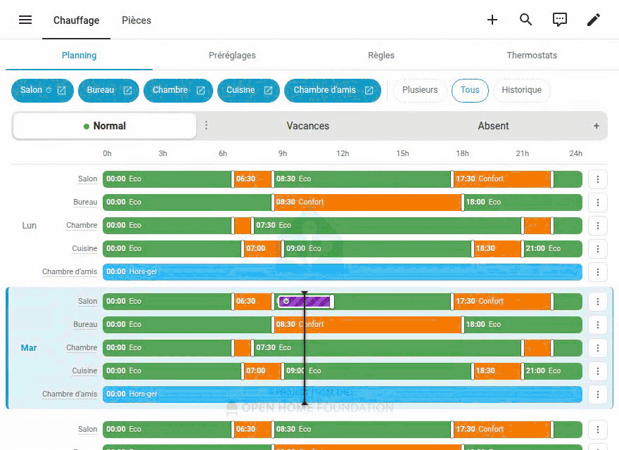

# ha-chauffage

[](https://github.com/armellarcier/ha-chauffage/actions/workflows/tests.yml)


[](https://buymeacoffee.com/TRlbXsQ2yu)

**English** · [Français](README.fr.md)



Weekly heating schedules for Home Assistant thermostats: thermostats without presets, with
presets, or **[Versatile Thermostat](https://github.com/jmcollin78/versatile_thermostat)**
(independent project, not affiliated with Versatile Thermostat):

- **schedules** you create, duplicate and name (*Normal*, *Remote work*, *Holidays*,
  *Away*…), each with a 7-day week per thermostat; one is active, switched from the card or by
  automations;
- visual Lovelace editor card (`custom:chauffage-programme-card`): drag time slots, copy /
  paste days, identical days on one row (*Mon–Fri*, *Every day*) edited at once, several
  thermostats per day, see the temperature measured over the last 7 days
  drawn over each day; made for phones too; every thermostat, schedule or setting it names opens
  in Home Assistant;
- a **thermostat card** (`custom:chauffage-thermostat-card`) to build your own dashboards: one
  thermostat, what it does now, why and until when, today, a temporary setpoint;
- **temporary overrides**: a setpoint changed by hand becomes temporary (2 h by default),
  shown and adjustable (its end, and its value: a preset or a temperature) on the card and in
  the thermostat's more-info dialog, which can also set one, then the thermostat falls back to
  its schedule. Going back
  to the slot's preset or setpoint, even with the thermostat's knob, resumes the schedule at once.

> The project's name is French (*chauffage* = heating); the integration and the card speak
> English and French.

## Installation

From v0.2, ha-chauffage is a **Home Assistant integration** configured from the UI: no YAML to
edit. Version 0.1 was a YAML package; [upgrading](#upgrading-from-the-package-v01) imports its
data automatically.

1. In HACS: ⋮ → *Custom repositories* → `https://github.com/armellarcier/ha-chauffage`, type
   *Integration*; then install **ha-chauffage** and restart Home Assistant.
2. Settings → Devices & services → *Add integration* → **Chauffage**.
3. Add the card to a dashboard (it is served by the integration: no resource to add): *Add card*
   → **Heating schedules**, or in YAML:
   ```yaml
   type: custom:chauffage-programme-card
   thermostats:
     - entity: climate.living_room
       name: Living room
   ```
   The card follows the user's language and formats (12 / 24 h, decimal separator, first day of
   the week); English and French are available, and `language: en` or `language: fr` forces one.
   Identical days share a row (*Mon–Fri*, *Sat, Sun*, *Every day*): editing the row edits each
   of its days. The *Group days* button shows each day on its own row (to make one day
   different), and `group_days: false` makes that the default.
   The thermostats, their names and the other options can also be set from the card's visual
   editor (Edit card); `language` and `group_days` are only set in YAML.
4. Optionally, a **Scheduled thermostat** card per room, to place in your own dashboards (it is
   suggested for a thermostat in *Add card* → *By entity*):
   ```yaml
   type: custom:chauffage-thermostat-card
   entity: climate.living_room
   name: Living room  # optional
   ```
   It shows the measured temperature, what the thermostat does now, why and until when
   ("Normal · Eco until 17:30, then Comfort"), today, a temporary setpoint to set or change,
   *Pause* (or *Resume*), and opens the thermostat, its schedule, its *Control* switch and its
   device. The thermostat's more-info dialog shows the same, under its controls.

Requires Home Assistant 2025.1 or later. This minimum only rises when a Home Assistant API
requires it, in a minor version announced in the [changelog](CHANGELOG.md); the tests run on it,
on one version per quarter since, on the latest Home Assistant and, every week, on the beta.

### What the integration provides

Vocabulary: a **schedule** is a weekly plan (*Normal*, *Holidays*…) with a **week** per
thermostat, made of **slots**; each slot asks for a **preset** (*Comfort*, *Eco*…); an
**override** is a temporary change on one thermostat ([glossary](docs/glossary.md)).

#### Schedules

- A new installation starts with a single schedule, *Normal*.
- In the card (admins), **+** creates a schedule: empty, or a copy of another one. **⋮** on the
  open tab renames, moves or deletes it.
- Each schedule has a **stable id**, shown in *Rename…*. It never changes, even when the
  schedule is renamed: automations use it.

#### Active schedule

One schedule is active at a time: the **Active schedule** select (`select.chauffage_schedule`).

- From the card: open the schedule's tab, then *Activate*.
- From an automation: the service `chauffage.activate_schedule` and the select's `schedule_id`
  attribute, both with the stable id.
- From a dashboard, a script or by voice: the select, or the switch of each schedule (see
  *Entities and services*).

For example, odd and even weeks:

```yaml
triggers:
  - trigger: time
    at: "00:00:00"
conditions:
  - condition: template
    value_template: "{{ now().weekday() == 0 }}"
actions:
  - action: chauffage.activate_schedule
    data:
      schedule: "{{ 'normal' if now().isocalendar().week % 2 == 0 else 'odd_weeks' }}"
```

#### Activation rules

Schedules activated by themselves, without writing an automation: the card's *Rules* view
(admins) holds an ordered list of rules.

- **The first rule that applies wins.** When none does, the default schedule is activated (or,
  without one, the active schedule stays).
- **A rule is a template**, in one of two ways:
  - a template and the schedule it activates while the template is true. True and false are
    read as in a template condition: `true`, `on`, `yes`, `1`…; any other text is false;
  - a template that gives the schedule itself, by its id or its name.
- **Rules are tried as you type them**: each one shows what its template gives now (or its
  error), and whether it applies.
- **A schedule chosen by hand stays** until the outcome of the rules changes. The select's
  `rules_choice` attribute says which schedule the rules give: an automation can go back to it
  at once with `chauffage.activate_schedule`.

For example, following the EDF Tempo color of the day, two rules and a default schedule:

| Template | Schedule |
|---|---|
| `{{ is_state('sensor.edf_tempo_color', 'red') }}` | *Away* |
| `{{ is_state('sensor.edf_tempo_color', 'white') }}` | *Eco days* |
| (none is true) | *Normal* (default) |

Or a single rule whose template gives the schedule:

```jinja
{{ {'red': 'away', 'white': 'eco_days'}.get(states('sensor.edf_tempo_color'), 'normal') }}
```

**A calendar of schedules**: add a *Local Calendar* (Settings › Devices & services › Add
integration), say `calendar.chauffage`, and put in it events named after schedules: *Holidays*
from Friday evening to Sunday, *Away* until Tuesday 18:00, *Remote work* every Wednesday (a
recurring event). One rule, and *Normal* as the default schedule:

```jinja
{{ state_attr('calendar.chauffage', 'message') if is_state('calendar.chauffage', 'on') }}
```

While an event runs, its title gives the schedule (its name, any case, or its id); between
events, the default schedule applies. A new schedule needs no change to the rule. Any calendar
works the same way (Google, CalDAV…), to plan from a phone or share with the household.

Events must not overlap with this rule: a calendar entity shows a single event, the one that
started first, so an evening *Away* inside a week of *Holidays* is not seen. For exceptions
inside a period, the blueprint
[`calendar_schedule.yaml`](blueprints/automation/chauffage/calendar_schedule.yaml) reads every
running event and writes the schedule of the one that started last into a text helper:

1. Create a *Text* helper (Settings › Devices & services › Helpers), say
   `input_text.calendar_schedule`.
2. [](https://my.home-assistant.io/redirect/blueprint_import/?blueprint_url=https%3A%2F%2Fgithub.com%2Farmellarcier%2Fha-chauffage%2Fblob%2Fmain%2Fblueprints%2Fautomation%2Fchauffage%2Fcalendar_schedule.yaml),
   then create an automation from it with the calendar and the helper.
3. The rule reads the helper: `{{ states('input_text.calendar_schedule') }}`.

Events whose title names no schedule are ignored. The schedule changes when an event starts or
ends; an event added or edited is seen within five minutes.

#### Presets

Slots ask for the integration's presets: by default *Comfort* 20 °C, *Eco* 17 °C, *Boost* 21 °C
and *Frost protection* 7 °C.

- **For each thermostat**, a preset is the thermostat's own preset with the same name when it
  has one, otherwise the preset's temperature. This can be changed per thermostat: one of its
  own presets, or a temperature.
- **Set in the card**, *Presets* view (admins): a table with one column per preset, from the
  coldest to the warmest, and one row per thermostat. A column header is the preset: its name,
  color and default temperature, changed in one popover, with *Delete…*; *+ Add a preset* is
  under the table. Each cell gives the temperature and says what it is: "its *Comfort* preset",
  "set here" or "default" ("?" until a thermostat's own preset has been used). A cell opens a
  popover to change it, as for the slots, with a link to the thermostat's device, where its own
  presets are set.
- **Temperatures shown**: the table and the legend show each preset's temperature. No standard
  attribute gives the temperature of a thermostat's own preset: the integration remembers the
  setpoint seen while that preset was active.
- **Versatile Thermostat bonus**: its preset temperatures are read directly from its attributes
  (`preset_temperatures` since VTherm 10, `comfort_temp`… before).

#### Entities and services

A thermostat is **scheduled** once it is in a card. It stays scheduled when it is removed from a
card (another card may show it), until it is forgotten. Paused, it is still scheduled: it keeps
its weeks, but Chauffage no longer controls it. The card's *Thermostats* view lists every
scheduled thermostat, paused or not, the ones in no card too, with their *Control* switch and
device. If its entity is deleted from Home
Assistant, Settings → Repairs proposes to forget it.

Everything Chauffage knows can be seen and used in Home Assistant, without the card: on the
device pages, in dashboards, automations, scripts and by voice. The entities appear by
themselves; they hold no state of their own (they show the integration's data and change it as
the card does), and their names and icons can be changed in Home Assistant.

Per scheduled thermostat, on the thermostat's device page:

| Entity | What it says |
|---|---|
| **Control** (switch) | Off, the thermostat is **paused**: Chauffage keeps its weeks but no longer controls it (nothing sent, no override), until it is turned back on. Handy for a room run by hand for a few days, or at the end of the heating season. |
| **Planned preset** (sensor) | The preset planned now. Attributes `preset_name`, `target`, `next_preset`, `next_preset_name`, `next_start`, and `temperatures`: the temperature of each preset on this thermostat. |
| **Override** (binary sensor) | On while the thermostat has an override. Attributes `kind` (`temperature` or `preset`), `value` (a temperature, or the thermostat's climate preset), `preset` (the Chauffage preset it was set to, if any), `end`. |
| **Override end** (sensor, disabled by default) | The end of the current override as a timestamp, for a dashboard tile. |

The sensors are unavailable while the thermostat is paused. An installation from before 0.6
keeps the planned preset sensor's former id (`sensor.<thermostat>_schedule`), and enables it once.

On the *Chauffage* device:

| Entity | What it says |
|---|---|
| **Active schedule** (select, `select.chauffage_schedule`) | The active schedule, to pick among all of them. Attributes `schedule_id`, and `rules_choice`: the schedule the activation rules give (empty without rules). |
| **&lt;Schedule&gt; schedule** (a switch per schedule, `switch.chauffage_schedule_<id>`) | On for the active schedule. Turning one on activates it; the active one is not turned off, another one is turned on. Its icon, chosen in Home Assistant, is shown on the schedule's tab in the card. |

**Assist**: Home Assistant exposes new switches to voice assistants, so "turn off the living room
control" or "turn on the Holidays schedule" work. Control switches made before 0.6 keep the
choice made then (not exposed); in Settings → Voice assistants → Expose, each entity can be
exposed or not.

Services:

- `chauffage.set_override`: a temperature or a preset (what that preset means on the thermostat,
  as in the card), for a duration or until a time.
- `chauffage.clear_override`: the thermostat resumes its schedule now.
- `chauffage.activate_schedule`: activates a schedule by its stable id.
- `chauffage.get_schedules` (with a response, for scripts): the schedules (`id`, `name`,
  `entity_id` of their switch), `active_schedule`, `rules_choice`, `default_schedule`.
- `chauffage.get_week` (with a response): the week of thermostats in a schedule (the active one by
  default): by thermostat, then by day like Home Assistant's `schedule.get_schedule`: `schedule`
  and one list per day (`monday`…), each slot with its `start`, `end` and `preset`.

```yaml
- action: chauffage.get_week
  data:
    entity_id: climate.salon
  response_variable: week
- action: notify.mobile_app_phone
  data:
    message: >-
      {% set tomorrow = (now() + timedelta(days=1)).strftime('%A') | lower %}
      Tomorrow the living room is in comfort from
      {{ week['climate.salon'][tomorrow] | selectattr('preset', 'eq', 'comfort') | map(attribute='start') | first }}
```

Events, for automations (*Event* trigger):

| Event | Data |
|---|---|
| `chauffage_override_started` | `entity_id`, `kind`, `value`, `preset`, `end`, and `source`: `thermostat` (a change made on it, by hand), `card`, `service`. Fired for a new override or a new value, not when only its end changes. |
| `chauffage_override_ended` | `entity_id`, and `reason`: `expired`, `thermostat` (put back to its schedule by hand), `card`, `service`, `paused`, `forgotten`. |
| `chauffage_schedule_activated` | `schedule` (id), `schedule_name`, `previous_schedule`, and `source`: `card`, `entity` (the select or a schedule switch), `service`, `rules`. |

For example, to be notified when someone changes a thermostat by hand:

```yaml
triggers:
  - trigger: event
    event_type: chauffage_override_started
    event_data:
      source: thermostat
actions:
  - action: notify.mobile_app_phone
    data:
      message: "{{ trigger.event.data.entity_id }}: {{ trigger.event.data.value }} until {{ as_datetime(trigger.event.data.end).strftime('%H:%M') }}"
```

#### Options

Settings → Devices & services → Chauffage → *Configure*:

- **Override duration**: 2 h by default.
- **Use the thermostats' presets**: on by default. Off, every thermostat is driven by
  temperatures, all set in the card.

### Upgrading from the package (v0.1)

1. Install the integration (steps 1–2 above) **without removing the package**: the setup
   offers to import its weeks, current overrides and active schedule (the package's "mode"),
   then turns off the package's two automations so that only one scheduler drives the
   thermostats.
2. Check the card and the thermostats. To go back, delete the integration and turn the two
   `automation.chauffage_*` automations back on: the package's data is untouched.
3. Follow the repair shown in Settings: delete `packages/chauffage/` and `www/chauffage/`,
   remove the `extra_module_url` line and the `recorder` exclusions from `configuration.yaml`,
   restart. In your automations, replace `input_select.mode_chauffage` with
   `select.chauffage_schedule`.

Upgrading the integration itself: read the [changelog](CHANGELOG.md) and update from HACS;
stored data is migrated automatically. Going back to an older version is not supported.

### Package installation (v0.1)

The [v0.1.0 release](https://github.com/armellarcier/ha-chauffage/releases/tag/v0.1.0) is a YAML
package, no longer maintained: unzip its ZIP into the configuration folder and follow the README
of that version.

### Supported thermostats

Any `climate` entity with a target temperature, tested with three kinds:

- **Versatile Thermostat**: presets use its own (`comfort`, `eco`, `boost`, `frost`), whose
  temperatures are set in VTherm; a setpoint changed by hand switches it to preset `none` and
  becomes an override;
- **thermostats with standard presets** (`eco`, `comfort`, `away`, `boost`…): presets use the
  thermostat's own with the same name, temperatures for the others (frost protection, for
  example);
- **thermostats without presets** (such as `generic_thermostat`): presets are temperatures; any
  setpoint changed by someone else becomes an override.

Not supported yet: heat / cool thermostats with a temperature range (`heat_cool`), and devices
that change their setpoint by themselves (they can look like manual changes). A device that keeps
its preset when its setpoint is changed by hand is better set to temperatures (the card's
*Presets* view). See the [roadmap](ROADMAP.md) for groups of thermostats and a calendar of
schedules.

## Repository layout

```
custom_components/chauffage/        the integration (scheduler, entities, services, websocket API)
custom_components/chauffage/frontend/  Lovelace card + block injected into the more-info dialog
dev/compose.yaml, dev/hass/         disposable development HA (Versatile Thermostat + simulated rooms)
dev/sim_rooms/, dev/sim_climate/    dev only: thermal model of the rooms (and a simulated week of
                                    history for a new dev HA), a climate with standard presets
tests/integration/, tests/js/       automated tests (pytest + in-memory HA, node --test + jsdom)
docs/                               glossary, design decisions, use cases and their tests
tests/fixtures/                     stored data in each past format (migration tests)
scripts/                            test.sh, logs.sh, demo.sh
.github/workflows/                  tests (CI), hassfest, HACS checks and releases
```

Development: see [CONTRIBUTING.md](CONTRIBUTING.md).

## How it works

- Data is stored in `.storage/chauffage` (versioned, migrated automatically): schedules, presets,
  weeks (`{climate: {schedule id: [7 days × [[start, preset], …]]}}`), current overrides.
- **Scheduler**: every minute, applies the preset of the slots starting now and resumes the
  schedule of thermostats whose override ends; it realigns every thermostat at startup, when
  a schedule is activated and when weeks are saved. Thermostats with an active override, turned
  off or unavailable are left alone; an unreachable valve does not stop the others.
- **Manual changes**: a setpoint changed by hand (the thermostat switches to preset `none`) or
  a preset picked by a user becomes a temporary override; going back the same way to what the
  slot gives (its preset, or a setpoint at that preset's temperature on this thermostat) ends
  it instead. Changes made by the integration itself
  (its own context) or by an automation are ignored.
- **Card**: served by the integration and loaded on every page (card + more-info block); it
  talks to the integration over websocket (`chauffage/subscribe`, `chauffage/weeks/save`…);
  a save made from an outdated copy is refused instead of overwriting someone else's changes.
- **History**: the card asks the integration for the measured temperature and the setpoint
  applied over the last 7 days (`chauffage/history`); the integration reads them from HA's
  recorder, keeps only these two values (HA's own history sends every attribute of a thermostat,
  megabytes for a week) and keeps what it read in memory, so the card's refreshes only read the
  last minutes.

Known pitfalls (already handled, covered by tests): ZHA presets are Enums; dates with
microseconds are rejected by Safari; `ha-card` renders asynchronously (popover positioning).

## License

[MIT](LICENSE) © 2026 Armel Larcier
