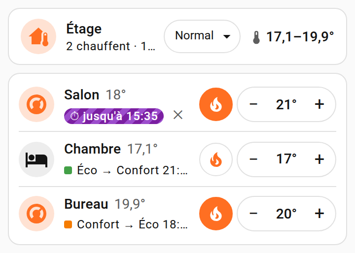

# Installation

[English](installation.md) · **Français**

ha-chauffage se configure depuis l'interface de Home Assistant. Vous n'avez aucun YAML à
modifier.

Nécessite Home Assistant 2025.1 ou plus récent. Le [journal des modifications](../CHANGELOG.md)
(en anglais) annonce quand la version minimale de Home Assistant augmente.

Si vous utilisez Versatile Thermostat, Chauffage nécessite Versatile Thermostat 10.5 ou plus
récent.

## 1. Installer l'intégration depuis HACS

[](https://my.home-assistant.io/redirect/hacs_repository/?owner=armellarcier&repository=ha-chauffage&category=integration)

Le bouton ouvre ha-chauffage dans le HACS de votre Home Assistant. Cliquez sur *Télécharger*,
puis redémarrez Home Assistant.

Sans le bouton, ouvrez HACS et cherchez **ha-chauffage**.

## 2. Ajouter l'intégration

Allez dans Paramètres → Appareils et services → *Ajouter une intégration*, puis choisissez
**Chauffage**.

Un panneau **Chauffage** apparaît alors dans la barre latérale, pour les administrateurs.
Ouvrez le panneau et cochez les thermostats que Chauffage doit piloter, par exemple trois. Puis
cliquez sur *Programmer 3 thermostats*. Voir [Le panneau Chauffage](panel.fr.md).

## 3. Ajouter la carte des plannings

Ajoutez la carte à un tableau de bord : *Ajouter une carte* → **Plannings de chauffe**. Dans
l'éditeur visuel de la carte, choisissez les thermostats et leurs noms.

Vous pouvez aussi écrire la carte en YAML :

```yaml
type: custom:chauffage-programme-card
thermostats:
  - entity: climate.salon
    name: Salon
```

**Langue.** La carte suit votre langue et vos formats, par exemple l'heure sur 12 ou 24 heures.
Pour imposer l'anglais ou le français, ajoutez `language: en` ou `language: fr`.

**Jours groupés.** Les jours identiques partagent une ligne, par exemple *Lun–Ven*. Pour rendre
un jour différent, désactivez *Grouper les jours*. La carte affiche alors chaque jour sur sa
propre ligne. Pour afficher chaque jour sur sa ligne par défaut, ajoutez `group_days: false`.

## 4. Ajouter une carte par pièce (facultatif)

La carte **Thermostat programmé** montre un seul thermostat, pour vos propres tableaux de bord.
Pour ajouter la carte, ouvrez *Ajouter une carte* et cherchez **Thermostat programmé**. Depuis
Home Assistant 2026.6, l'onglet *Par entité* d'*Ajouter une carte* propose aussi la carte pour
chaque thermostat.

Vous pouvez aussi écrire la carte en YAML :

```yaml
type: custom:chauffage-thermostat-card
entity: climate.salon
name: Salon  # facultatif
```

Depuis la carte, vous pouvez créer une dérogation et suspendre le pilotage du thermostat.

Pour modifier la semaine du thermostat, cliquez sur *Modifier sa semaine* dans la fenêtre de
détail du thermostat.

## 5. Ajouter une liste des pièces et un résumé (facultatif)



Ces deux cartes sont des prototypes. Elles conviennent aux tableaux de bord qui ont beaucoup de
pièces, par exemple une tuile par étage qui ouvre une fenêtre avec ses pièces.

**La carte Pièces** montre une ligne par thermostat. Chaque ligne dit ce que fait le thermostat
et ce qui suit, par exemple *Éco → Confort 06:30*. Le **−** et le **+** règlent la consigne, et
le bouton rond règle le mode. Chauffage en fait une dérogation, comme avec la molette du
thermostat. Un appui sur la ligne ouvre le thermostat.

**La carte Résumé du chauffage** montre un étage ou la maison sur une ligne : la plage des
températures mesurées dans ses pièces, et de leur humidité si les thermostats la donnent, le
nombre de thermostats qui chauffent et les dérogations. Son bouton montre le planning actif, et
ouvre un menu pour en activer un autre. Vous pouvez masquer ce bouton. Un appui ailleurs lance
l'action de la carte, par exemple pour ouvrir la fenêtre des pièces.

Pour les ajouter, ouvrez *Ajouter une carte* et cherchez **Pièces** ou **Résumé du chauffage**.
Sans liste de thermostats, chaque carte montre tous les thermostats que Chauffage programme.
Vous pouvez aussi écrire les cartes en YAML :

```yaml
type: custom:chauffage-rooms-card
thermostats:        # facultatif
  - climate.salon
  - entity: climate.chambre
    name: Chambre   # facultatif
    icon: mdi:bed   # facultatif
```

```yaml
type: custom:chauffage-summary-card
name: Étage                             # facultatif
thermostats: [climate.salon, climate.chambre]  # facultatif
show_schedules: false                   # facultatif : masque le bouton des plannings
tap_action:                             # facultatif
  action: navigate
  navigation_path: "#pieces"
```

## Mettre à jour

Lisez le [journal des modifications](../CHANGELOG.md) (en anglais), puis mettez ha-chauffage à
jour depuis HACS. Chauffage migre vos données automatiquement. Vous ne pouvez pas revenir à une
version antérieure.

## Mise à jour depuis le package (v0.1)

La version 0.1 d'ha-chauffage était un package YAML. Pour quitter le package, installez
d'abord ha-chauffage 0.10.0, la dernière version qui importe les données du package. Suivez les
étapes de [son guide d'installation](https://github.com/armellarcier/ha-chauffage/blob/v0.10.0/docs/installation.fr.md#mise-%C3%A0-jour-depuis-le-package-v01).
Puis mettez à jour vers la dernière version.

Le package n'est plus maintenu. La
[version v0.1.0](https://github.com/armellarcier/ha-chauffage/releases/tag/v0.1.0) le contient
toujours, avec son propre README.
