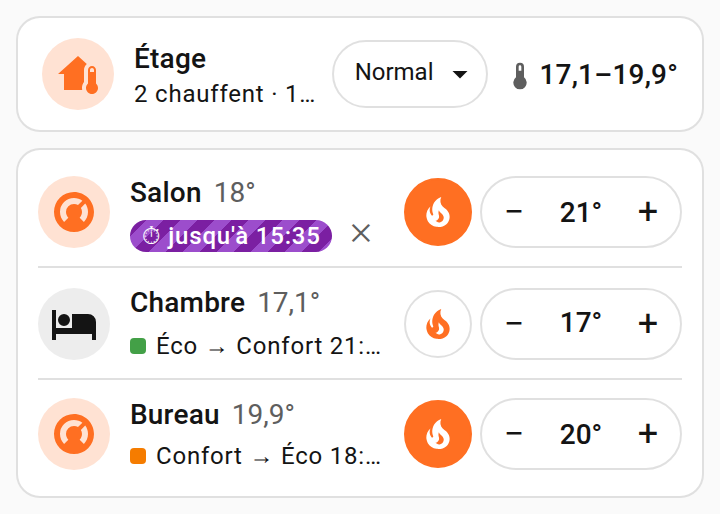

# Installation

**English** · [Français](installation.fr.md)

You set ha-chauffage up from the Home Assistant UI. You don't need to edit any YAML.

Requires Home Assistant 2025.1 or later. The [changelog](../CHANGELOG.md) announces when the
minimum Home Assistant version rises.

## 1. Install the integration from HACS

[](https://my.home-assistant.io/redirect/hacs_repository/?owner=armellarcier&repository=ha-chauffage&category=integration)

The button opens ha-chauffage in the HACS of your Home Assistant. Click *Download*, then restart
Home Assistant.

Without the button, open HACS and search for **ha-chauffage**.

## 2. Add the integration

Go to Settings → Devices & services → *Add integration*, and choose **Chauffage**.

A **Chauffage** panel then appears in the sidebar, for administrators. Open the panel and tick the
thermostats Chauffage controls, for example three. Then click *Schedule 3 thermostats*. See
[The Chauffage panel](panel.md).

## 3. Add the schedule card

Add the card to a dashboard: *Add card* → **Heating schedules**. In the card's visual editor,
choose the thermostats and their names.

You can also write the card in YAML:

```yaml
type: custom:chauffage-programme-card
thermostats:
  - entity: climate.living_room
    name: Living room
```

**Language.** The card follows your language and your formats, for example the 12 or 24-hour
clock. To force English or French, add `language: en` or `language: fr`.

**Grouped days.** Identical days share a row, for example *Mon–Fri*. To make one day different,
turn off *Group days*. The card then shows each day on its own row. To show each day on its own
row by default, add `group_days: false`.

## 4. Add a card for each room (optional)

The **Scheduled thermostat** card shows one thermostat, for your own dashboards. To add the card,
open *Add card* and search for **Scheduled thermostat**. From Home Assistant 2026.6, the
*By entity* tab of *Add card* also suggests the card for each thermostat.

You can also write the card in YAML:

```yaml
type: custom:chauffage-thermostat-card
entity: climate.living_room
name: Living room  # optional
```

From the card, you can start an override and pause the thermostat.

To edit the thermostat's week, click *Edit its week* in the more-info dialog.

## 5. Add a list of rooms and a summary (optional)



These two cards are prototypes. They suit dashboards with many rooms, for example a tile per
floor that opens a pop-up of its rooms.

**The Rooms card** shows one row per thermostat. Each row says what the thermostat does now and
what comes next, for example *Éco → Confort 06:30*. The **−** and **+** set the setpoint, and the
round button sets the HVAC mode. Chauffage turns these changes into an override, as with the
thermostat's dial. A tap on the row opens the thermostat.

**The Heating summary card** shows a floor or the house in one row: its temperature, how many
thermostats heat and the overrides. Its button shows the active schedule, and opens a menu to
activate another one. You can hide this button: the card then shows the range of temperatures
its rooms measure, if you gave it a temperature sensor. A tap elsewhere runs the card's action, for
example to open the pop-up of the rooms.

To add them, open *Add card* and search for **Rooms** or **Heating summary**. Without a list of
thermostats, each card shows every thermostat Chauffage schedules. You can also write the cards
in YAML:

```yaml
type: custom:chauffage-rooms-card
thermostats:        # optional
  - climate.living_room
  - entity: climate.bedroom
    name: Bedroom   # optional
    icon: mdi:bed   # optional
```

```yaml
type: custom:chauffage-summary-card
name: Upstairs                          # optional
temperature: sensor.upstairs_temperature  # optional
humidity: sensor.upstairs_humidity        # optional
thermostats: [climate.living_room, climate.bedroom]  # optional
show_schedules: false                   # optional: hides the button of the schedules
tap_action:                             # optional
  action: navigate
  navigation_path: "#rooms"
```

## Updating

Read the [changelog](../CHANGELOG.md), then update ha-chauffage from HACS. Chauffage migrates your
stored data automatically. You can't go back to an older version.

## Upgrading from the package (v0.1)

Version 0.1 of ha-chauffage was a YAML package. The integration imports the package's data.

1. Install the integration (steps 1 and 2 above). **Don't remove the package yet.** The setup
   tells you what it imports, for example the package's weeks and its active schedule. Submit the
   setup to import them. Then the setup turns off the package's two automations.
2. Check the card and the thermostats. To go back to the package, delete the integration and
   turn the two `automation.chauffage_*` automations back on.
3. Follow the repair that Home Assistant shows in Settings. The repair tells you which files and
   lines to remove, then asks you to restart Home Assistant.
4. In your automations, replace `input_select.mode_chauffage` with `select.chauffage_schedule`.

The package is no longer maintained. The
[v0.1.0 release](https://github.com/armellarcier/ha-chauffage/releases/tag/v0.1.0) still holds
it, with its own README.
