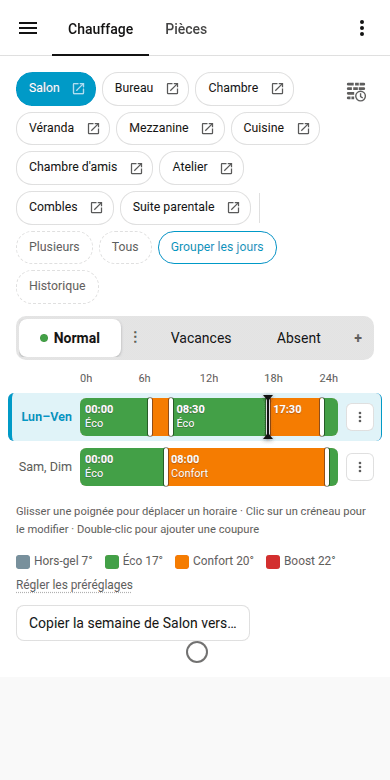

# Dérogations

[English](overrides.md) · **Français**

**Votre thermostat a repris son planning ?** Vous avez changé sa consigne à la main, et
Chauffage n'a gardé votre changement qu'un temps. Chauffage appelle ce changement temporaire une
*dérogation*.

**Combien de temps dure un changement à la main.** Par défaut, votre changement dure 2 heures,
quel que soit le planning. Par exemple, vous montez le salon à 22 °C à 21 h 30. Le salon reprend
son planning à 23 h 30. Vous changez la consigne à la main avec la molette du thermostat, ou dans
Home Assistant.

## Choisir combien de temps dure une dérogation

Touchez le bouton ⚙ du panneau Chauffage pour ouvrir les réglages. Un administrateur peut aussi
toucher la fin d'une dérogation sur la carte. Sous *Dérogations*, réglez la *Durée*, puis
choisissez l'une des trois fins.

Prenons un salon en *Confort* jusqu'à 22 h 30, et un bureau dont le prochain créneau est à 6 h.

| Fin des dérogations | Votre changement dure… | Salon monté à 21 h 30 | Bureau monté à 18 h 30 |
|---|---|---|---|
| **Pendant la durée des dérogations** (par défaut) | la durée des dérogations, 2 heures par défaut | jusqu'à 23 h 30 | jusqu'à 20 h 30 |
| **Pendant la durée, ou moins si un créneau commence avant** | la durée des dérogations, ou jusqu'au prochain créneau s'il commence avant | jusqu'à 22 h 30 | jusqu'à 20 h 30 |
| **Jusqu'au prochain créneau** | jusqu'au prochain créneau, aussi loin soit-il, comme sur un thermostat classique | jusqu'à 22 h 30 | jusqu'à 6 h |

Le prochain créneau est le premier créneau qui change ce que fait le thermostat, par exemple sa
consigne ou son mode HVAC.

Le réglage vaut pour tous les thermostats. Vous pouvez aussi changer ce réglage dans les
[options](panel.fr.md#options), ou avec les [entités](automations.fr.md#sur-lappareil-chauffage)
de l'appareil Chauffage. Par exemple, une automatisation peut choisir *Jusqu'au prochain
créneau* pendant les vacances.

## Garder un changement plus longtemps

Pour prolonger une dérogation d'un seul geste, touchez *+30 min*, *+1 h* ou *+2 h* sous la
dérogation. Sur la carte d'une pièce, touchez d'abord *Modifier*.

Pour arrêter la dérogation à une heure précise, réglez sa fin sur la carte, ou dans la fenêtre de
détail du thermostat. Par exemple, réglez-la sur demain 18 h. Les créneaux d'ici là n'arrêtent
pas la dérogation.

Pour garder un seul changement jusqu'au prochain créneau, quel que soit le réglage, touchez le
bouton sous la dérogation, par exemple *Jusqu'à 17:30 (prochain créneau)*.

## Créer une dérogation

- **Sur le thermostat.** Changez la consigne ou le préréglage à la main, avec la molette ou dans
  Home Assistant.
- **Depuis la carte**, ou depuis la fenêtre de détail du thermostat. Choisissez *Éteint*, un
  préréglage ou une température. Tous les utilisateurs peuvent créer une dérogation, pas
  seulement les administrateurs. Sur une climatisation, vous pouvez aussi choisir le mode HVAC.
  Voir [Climatisations](air-conditioners.fr.md).
- **Depuis une automatisation**, avec l'action `chauffage.set_override`.

Un changement qu'une automatisation ou un script fait directement sur le thermostat n'est pas
une dérogation. Par exemple, un script qui éteint tous les thermostats le soir avec
`climate.turn_off` les laisse éteints jusqu'au créneau du matin.

## Arrêter une dérogation

Une dérogation s'arrête d'elle-même, et le thermostat reprend son planning. Pour arrêter une
dérogation plus tôt, au choix :

- touchez *Reprendre le planning* sur la carte ;
- remettez le thermostat sur le préréglage ou la consigne prévus, même avec la molette ;
- appelez l'action `chauffage.clear_override`.

## Éteindre un thermostat à la main

Éteindre un thermostat, avec son bouton ou dans Home Assistant, crée une dérogation comme une
autre. Par défaut, le thermostat reste éteint jusqu'au prochain créneau qui le change, même
lointain. Chauffage rallume alors le thermostat.

Sur un Versatile Thermostat, l'extinction à la main devient une dérogation à partir de
Versatile Thermostat 10.5.

**Combien de temps un thermostat reste éteint.** Dans les réglages, sous *Dérogations*, le
réglage *Thermostat éteint* offre les trois mêmes choix que la fin des autres dérogations. Le
choix par défaut est *Jusqu'au prochain créneau*. Le réglage vaut aussi quand vous touchez
*Éteint* sur la carte, et quand une automatisation appelle `chauffage.set_override` avec
`hvac_mode: off` et sans fin.

**Éteint jusqu'au matin.** Touchez *Jusqu'à demain 06:30* sous la dérogation. Le thermostat reste
éteint jusqu'au premier créneau du matin.

**Éteint plus longtemps.** Suspendez le pilotage du thermostat avec *Suspendre le pilotage*, ou
donnez au thermostat un planning dont les créneaux sont *Éteint*.

**Rallumer plus tôt.** Touchez *Reprendre le planning* sur la carte.

**Un Versatile Thermostat qui s'éteint de lui-même**, par exemple pour une fenêtre ouverte, n'a
pas de dérogation. Le Versatile Thermostat se rallume tout seul quand la fenêtre se ferme.
