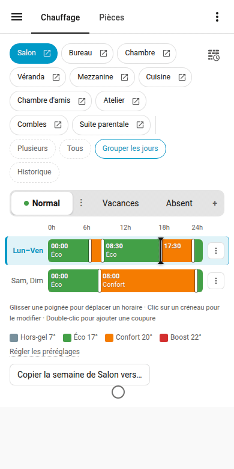

# Overrides

**English** · [Français](overrides.fr.md)

**Your thermostat went back to its schedule?** You changed its setpoint by hand, and Chauffage
kept your change for a while only. Chauffage calls this temporary change an *override*.

**How long a change by hand lasts.** By default, your change lasts 2 hours, whatever the
schedule. For example, you raise the living room to 22 °C at 21:30. The living room goes back
to its schedule at 23:30. You change the setpoint by hand with the thermostat's knob, or in Home
Assistant.

## Choose how long an override lasts

Tap the ⚙ of the Chauffage panel to open the settings. An administrator can also tap the end of
an override on the card. Under *Overrides*, set the *Duration*, then choose one of three ends.

Take a living room in *Comfort* until 22:30, and an office whose next slot is at 6:00.

| End of overrides | Your change lasts… | Living room raised at 21:30 | Office raised at 18:30 |
|---|---|---|---|
| **For the override duration** (default) | the override duration, 2 hours by default | until 23:30 | until 20:30 |
| **For the override duration, or less if a slot starts first** | the override duration, or until the next slot if the next slot starts sooner | until 22:30 | until 20:30 |
| **Until the next slot** | until the next slot, however far, as on a classic thermostat | until 22:30 | until 6:00 |

The next slot is the next one that changes what the thermostat does, for example its setpoint
or its HVAC mode.

The setting applies to every thermostat. You can also change the setting in the
[options](panel.md#options), or with the [entities](automations.md#on-the-chauffage-device) of
the Chauffage device. For example, an automation can choose *Until the next slot* during the
holidays.

## Keep a change longer

To give an override more time in one tap, tap *+30 min*, *+1 h* or *+2 h* under the override.
On a room's thermostat card, tap *Change* first.

To end the override at a given time, set its end on the card, or in the thermostat's more-info
dialog. For example, set it to tomorrow 18:00. The slots in between don't end the override.

To keep one change until the next slot, whatever the setting, tap the button under the override,
for example *Until 17:30 (next slot)*.

## Start an override

- **On the thermostat.** Change the setpoint or the preset by hand, with the knob or in Home
  Assistant.
- **From the card**, or from the thermostat's more-info dialog. Choose *Off*, a preset or a
  temperature. Every user can start an override, not only administrators. On an air
  conditioner, you can also choose the HVAC mode. See [Air conditioners](air-conditioners.md).
- **From an automation**, with the `chauffage.set_override` action.

A change that an automation or a script makes directly on the thermostat is not an override.
For example, a script that turns every thermostat off in the evening with `climate.turn_off`
leaves them off until the morning slot.

## End an override

An override ends by itself, and the thermostat goes back to its schedule. To end an override
sooner, do one of these:

- tap *Resume the schedule* on the card;
- set the thermostat back to the planned preset or setpoint, even with the knob;
- call the `chauffage.clear_override` action.

## Turn a thermostat off by hand

Turning a thermostat off, with its button or in Home Assistant, is an override like any other.
By default, the thermostat stays off until the next slot that changes it, however far. Then
Chauffage turns the thermostat back on.

On a Versatile Thermostat, turning off by hand is an override from Versatile Thermostat 10.5.

To turn rooms on and off yourself, without an override, see
[Turn rooms on and off yourself](#turn-rooms-on-and-off-yourself).

**How long a thermostat stays off.** In the settings, under *Overrides*, the setting *Turned
off* has the same three choices as the end of the other overrides. The default is *Until the
next slot*. The setting also applies when you tap *Off* on the card, and when an automation
calls `chauffage.set_override` with `hvac_mode: off` and no end.

**Off until the morning.** Tap *Until tomorrow 06:30* under the override. The thermostat stays
off until the first slot of the morning.

**Off for longer.** Pause the thermostat's control with *Pause control*, or give the thermostat
a schedule whose slots are *Off*.

**Back on sooner.** Tap *Resume the schedule* on the card.

**A Versatile Thermostat that turns itself off**, for example for an open window, has no
override. The Versatile Thermostat turns itself back on when the window closes.

## Turn rooms on and off yourself

Do you turn rooms on and off by hand, as people come and go? Turn off the setting *Control the
HVAC mode*. Chauffage then leaves the HVAC mode to you, as before version 0.10.

**What changes.**

- Chauffage never turns a thermostat on or off, and never switches it between heat and cool.
- Turning a thermostat off or on by hand is not an override.
- A thermostat that you turned off gets nothing until you turn it back on. Chauffage then sets
  it to its slot.
- A Versatile Thermostat keeps getting its slots while it is off. So it starts again on the
  right preset.
- On an air conditioner, the HVAC mode that you chose picks the preset's temperature. For
  example, *Comfort* gives 25 °C while the air conditioner cools.

A setpoint changed by hand is still an override.

**Where to set it.** For the whole house, open the ⚙ of the Chauffage panel, or the options of
the integration (*Configure*). For one thermostat, open its page in the panel, then its ⚙, and
choose *As the house*, *On* or *Off*.

**Your weeks change.** Before the setting turns off, the panel or the options list the slots that
change. You then confirm or cancel. A slot without a preset, such as *Off* or *Fan only*, is removed, and
the slot before it goes on. A *Heat* or *Cool* slot keeps its preset and loses its HVAC mode.
Turning the setting back on changes nothing in the weeks.
