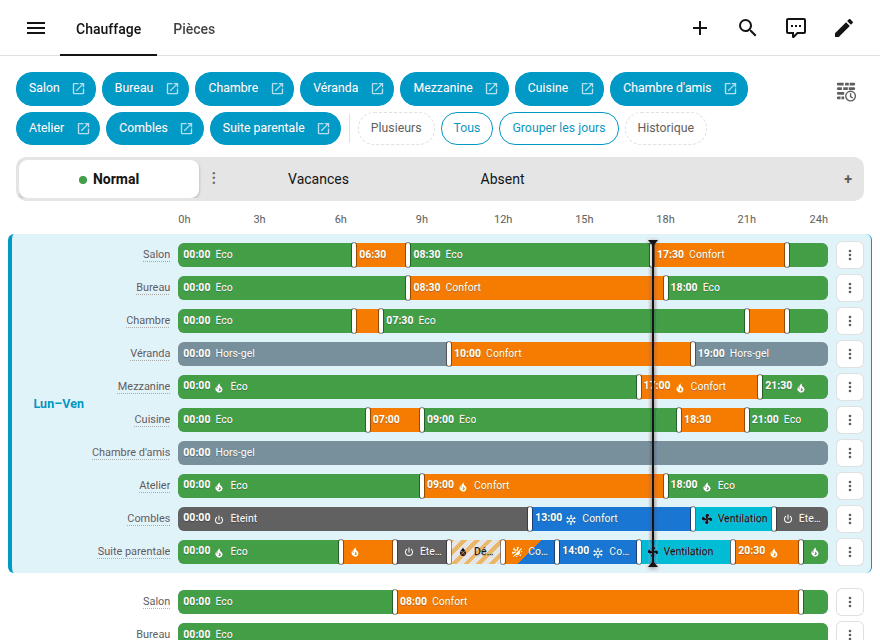

# Préréglages

[English](presets.md) · **Français**

Les créneaux demandent des préréglages. Chauffage est livré avec quatre préréglages :
*Confort* 20 °C, *Éco* 17 °C, *Boost* 22 °C et *Hors-gel* 7 °C.

## Ce que fait un préréglage sur chaque thermostat

**Un préréglage a deux températures** : une *en chauffe* et une *en clim*. Chacune peut rester
vide. Une nouvelle installation a ces préréglages :

| Préréglage | En chauffe | En clim |
|---|---|---|
| *Hors-gel* | 7 °C | aucune |
| *Éco* | 17 °C | 27 °C |
| *Confort* | 20 °C | 25 °C |
| *Boost* | 22 °C | 23 °C |

**Sur chaque thermostat.** Si le thermostat a son propre préréglage du même nom, Chauffage
utilise ce préréglage. Par exemple, *Confort* utilise le préréglage `comfort` du thermostat.
Sinon, Chauffage règle la température du préréglage. Vous pouvez changer ce choix pour chaque
thermostat, dans l'onglet *Préréglages* du panneau.

**Le préréglage propre d'un thermostat peut garder l'ancienne consigne.** Sur une Daikin, par
exemple, *eco* et *boost* ne règlent pas de température. Le *Boost* de Chauffage garde alors la
consigne qu'avait l'appareil, et pas 22 °C. Pour avoir 22 °C, saisissez une température dans la
case de ce thermostat, dans l'onglet *Préréglages*.

**Un préréglage ne sert que dans les modes HVAC où il a une température.** Un thermostat peut
utiliser un préréglage en *Chauffe* si le préréglage a une température en chauffe, et en *Clim*
si le préréglage a une température en clim. *Chauffe/Clim* demande les deux températures. Par
exemple, une climatisation ne climatise jamais en *Hors-gel*.

Un préréglage peut aussi régler le ventilateur et les volets d'une climatisation. Pour choisir ce
que fait une climatisation dans chaque créneau, voir [Climatisations](air-conditioners.fr.md).

**Éteindre tous les thermostats.** Un préréglage n'éteint jamais un thermostat. Pour éteindre
tous les thermostats, créez un planning dont les créneaux sont *Éteint*, par exemple *Absent*.

## Régler les préréglages dans le panneau Chauffage

Ouvrez le panneau Chauffage, puis l'onglet *Préréglages*. Le tableau a une colonne par
préréglage et une ligne par thermostat. Qui peut modifier les préréglages dépend du
[niveau d'accès](panel.fr.md#qui-peut-modifier-quoi).

**Modifier un préréglage.** Touchez l'en-tête de sa colonne. Vous pouvez changer son nom, sa
couleur et ses températures. Videz une température pour la retirer, par exemple pour qu'un
préréglage ne climatise plus. Vous ne pouvez pas vider une température qu'un créneau utilise.
Vous pouvez aussi supprimer le préréglage à cet endroit. Pour ajouter un préréglage, touchez
*+ Ajouter un préréglage* sous le tableau.

**Modifier un préréglage sur un seul thermostat.** Touchez la case du thermostat, puis
choisissez l'une de ces options.

- *Par défaut*. Le thermostat utilise son propre préréglage s'il porte le même nom, et sinon la
  température du préréglage.
- *Son préréglage*. Vous choisissez l'un des préréglages propres au thermostat.
- *Température*. Vous saisissez une température pour ce thermostat seulement.

Sur une climatisation qui chauffe et climatise, vous pouvez aussi saisir une température pour
la clim. *Plus de réglages* règle le ventilateur et les volets. *Copier depuis le thermostat*
remplit les champs avec ce que fait le thermostat en ce moment. Touchez *OK* pour
garder votre choix.

Vous réglez les préréglages propres au thermostat sur la page de son appareil, dans Home
Assistant. La carte affiche « ? » pour l'un de ces préréglages tant que le préréglage n'a pas été
actif une fois.
