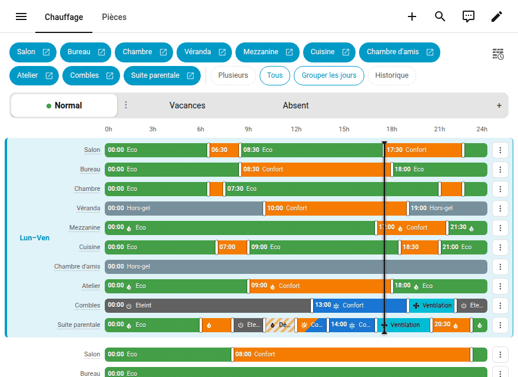

# Presets

**English** · [Français](presets.fr.md)

Slots ask for presets. Chauffage comes with four presets: *Comfort* 20 °C, *Eco* 17 °C,
*Boost* 22 °C and *Frost protection* 7 °C.

## What a preset does on each thermostat

**A preset has two temperatures**: one *when heating* and one *when cooling*. Either can be
empty. A new installation has these presets:

| Preset | When heating | When cooling |
|---|---|---|
| *Frost protection* | 7 °C | none |
| *Eco* | 17 °C | 27 °C |
| *Comfort* | 20 °C | 25 °C |
| *Boost* | 22 °C | 23 °C |

**On each thermostat.** If the thermostat has its own preset with the same name, Chauffage uses
that preset. For example, *Comfort* uses the thermostat's `comfort` preset. Otherwise, Chauffage
sets the preset's temperature. You can change this for each thermostat in the *Presets* tab of
the panel.

**A thermostat's own preset may keep the old setpoint.** On a Daikin, for example, *eco* and
*boost* don't set a temperature. Chauffage's *Boost* then keeps the setpoint the unit had, not
22 °C. To get 22 °C, set a temperature in that thermostat's cell of the *Presets* tab.

**A preset only works in the HVAC modes where it has a temperature.** A thermostat can use a
preset in *Heat* when the preset has a temperature when heating, and in *Cool* when the preset
has a temperature when cooling. *Heat/Cool* needs both temperatures. For example, an air
conditioner never cools on *Frost protection*.

A preset can also set the fan and the vanes of an air conditioner. To choose what an air
conditioner does in each slot, see [Air conditioners](air-conditioners.md).

**Turn every thermostat off.** A preset never turns a thermostat off. To turn every thermostat
off, create a schedule whose slots are *Off*, for example *Away*.

## Set the presets in the Chauffage panel

Open the Chauffage panel, then the *Presets* tab. The table has a column for each preset and a
row for each thermostat. Who may change the presets depends on the
[access level](panel.md#who-may-change-what).

**Change a preset.** Tap its column header. You can change its name, its color and its
temperatures. Empty a temperature to remove it, for example to stop a preset from cooling. You
can't empty a temperature that a slot uses. You can also delete the preset there. To add a
preset, tap *+ Add a preset* under the table.

**Change a preset on one thermostat.** Tap the thermostat's cell, then choose one of these
options.

- *Default*. The thermostat uses its own preset with the same name, or else the preset's
  temperature.
- *Its preset*. You choose one of the thermostat's own presets.
- *Temperature*. You type a temperature for this thermostat only.

On an air conditioner that heats and cools, you can also set a temperature for cooling.
*More settings* sets the fan and the vanes. *Copy from the thermostat* fills the fields with what
the thermostat does now. Tap *OK* to keep your choice.

You set the thermostat's own presets on its device page in Home Assistant. The card shows "?"
for one of these presets until the preset has been active once.
