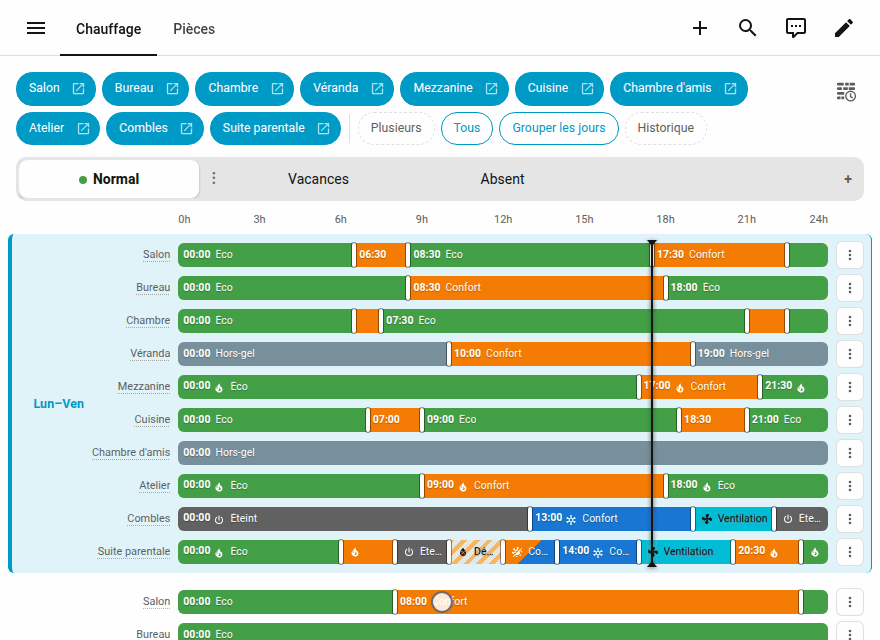

# Plannings

[English](schedules.md) · **Français**

Un **planning** est un programme pour la semaine, par exemple *Normal* ou *Vacances*. Un planning
contient une **semaine** pour chaque thermostat. Une semaine se compose de **créneaux**, et
chaque créneau demande un **préréglage**, par exemple *Confort* ou *Éco*. Le
[glossaire](glossary.md) (en anglais) définit ces mots.

Sur une climatisation, chaque créneau choisit aussi un mode HVAC, par exemple *Clim* (voir
[Climatisations](air-conditioners.fr.md)).



## Créer un planning

Une nouvelle installation démarre avec un seul planning, *Normal*. Dans la carte, touchez **+**
pour créer un planning, vide ou copié d'un autre planning. Pour renommer, déplacer ou supprimer
un planning, ouvrez son onglet et touchez **⋮**. Qui peut modifier les plannings dépend du
[niveau d'accès](panel.fr.md#qui-peut-modifier-quoi).

Chaque planning a un **identifiant stable**, affiché dans *Renommer…*. L'identifiant stable ne
change jamais, même si vous renommez le planning. Utilisez l'identifiant stable dans vos
automatisations.

## Modifier une semaine

Dans la carte, ouvrez l'onglet du planning, puis modifiez la semaine du thermostat. Vos
modifications s'appliquent une fois enregistrées.

- **Changer le préréglage d'un créneau.** Touchez le créneau, puis touchez un préréglage.
- **Ajouter un créneau.** Touchez deux fois un créneau, à l'heure où le nouveau créneau doit
  commencer. Vous pouvez aussi toucher le créneau, puis *+ Insérer un créneau*. La carte coupe
  alors le créneau et sélectionne un nouveau créneau en son milieu.
- **Déplacer le début d'un créneau.** Faites glisser la poignée entre deux créneaux, ou tapez
  l'heure dans le champ *de* du créneau.
- **Supprimer un créneau.** Touchez le créneau, puis *Supprimer*. Le créneau précédent prend sa
  place. Pour le premier créneau de la journée, c'est le créneau suivant qui prend sa place.
- **Copier une journée.** Ouvrez le menu **⋮** du jour, puis touchez *Copier la journée*. Ouvrez
  le menu ⋮ d'un autre jour, puis touchez *Coller*. Le même menu copie une journée vers
  *Lun–Ven*, vers *Sam–Dim* ou vers tous les jours.
- **Modifier d'un coup des jours identiques.** Quand *Grouper les jours* est activé, les jours
  identiques partagent une ligne. Modifier la ligne modifie chacun de ses jours.
- **Copier une journée vers d'autres thermostats.** Affichez plusieurs thermostats avec
  *Plusieurs*, puis touchez *Copier vers les autres thermostats* dans le menu ⋮ du jour.
- **Enregistrer.** Touchez *Enregistrer* dans la barre *Modifications non enregistrées*, ou
  *Annuler* pour abandonner vos modifications.

## Voir ce qui s'est passé : l'historique

L'historique reste masqué tant que vous ne touchez pas *Historique* en haut de la carte. Chaque
ligne montre alors le dernier jour de son nom. Par exemple, la ligne du lundi montre lundi
dernier. La carte trace la température mesurée, et la consigne appliquée en pointillés.

Pour agrandir un jour, ouvrez le menu ⋮ du jour, puis touchez *Voir la journée en grand*. Quand
la carte montre un seul thermostat, vous pouvez aussi toucher le nom du jour. Dans le jour
agrandi, faites glisser le doigt ou passez la souris pour lire l'heure, la température mesurée
et la consigne.

## Éteindre un thermostat depuis un créneau

Ouvrez le créneau, puis touchez **Éteint**. Le thermostat s'éteint au début du créneau, et se
rallume au prochain créneau qui demande un préréglage.

**Garder une pièce éteinte toute la nuit.** Une nuit, ce sont deux créneaux : le dernier
créneau d'un jour et le premier créneau du lendemain. Mettez les deux créneaux sur *Éteint*.

## Changer de planning actif

Un seul planning est actif à la fois. Le sélecteur **Planning actif**
(`select.chauffage_schedule`) indique lequel.

- **Depuis la carte**, ouvrez l'onglet du planning, puis touchez *Activer*.
- **Depuis le panneau Chauffage**, sur l'onglet *Plannings*, ouvrez le menu ⋮ du planning, puis
  touchez *Activer*.
- **Depuis une automatisation**, appelez `chauffage.activate_schedule` avec l'identifiant stable
  du planning. L'attribut `schedule_id` du sélecteur donne l'identifiant stable du planning
  actif.
- **Depuis un tableau de bord, un script ou à la voix**, utilisez le sélecteur ou l'interrupteur
  du planning (voir [Entités](automations.fr.md#entités)).
- **Pour en changer automatiquement**, écrivez des [règles d'activation](activation-rules.fr.md).

Par exemple, cette automatisation alterne deux plannings, les semaines paires et impaires :

```yaml
triggers:
  - trigger: time
    at: "00:00:00"
conditions:
  - condition: template
    value_template: "{{ now().weekday() == 0 }}"
actions:
  - action: chauffage.activate_schedule
    data:
      schedule: "{{ 'normal' if now().isocalendar().week % 2 == 0 else 'semaines_impaires' }}"
```
