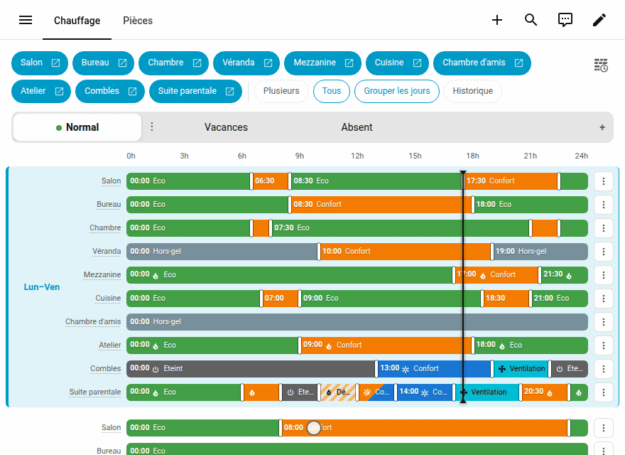

# Schedules

**English** · [Français](schedules.fr.md)

A **schedule** is a weekly plan, for example *Normal* or *Holidays*. A schedule holds a **week**
for each thermostat. A week is made of **slots**, and each slot asks for a **preset**, for
example *Comfort* or *Eco*. The [glossary](glossary.md) defines these words.

On an air conditioner, each slot also chooses an HVAC mode, for example *Cool* (see
[Air conditioners](air-conditioners.md)).



## Create a schedule

A new installation starts with one schedule, *Normal*. In the card, tap **+** to create a
schedule, empty or as a copy of another schedule. To rename, move or delete a schedule, open its
tab and tap **⋮**. Who may change the schedules depends on the
[access level](panel.md#who-may-change-what).

Each schedule has a **stable id**, shown in *Rename…*. The stable id never changes, even when you
rename the schedule. Use the stable id in your automations.

## Edit a week

In the card, open the schedule's tab, then edit the thermostat's week. Your changes apply once
you save them.

- **Change a slot's preset.** Tap the slot, then tap a preset.
- **Add a slot.** Double-tap a slot where the new slot should start. You can also tap the slot,
  then *+ Insert a slot*. The card then cuts the slot and selects a new slot in its middle.
- **Move a slot's start.** Drag the handle between two slots, or type the time in the slot's
  *from* field.
- **Delete a slot.** Tap the slot, then *Delete*. The slot before takes over the deleted slot's
  time. For the first slot of the day, the next slot takes over.
- **Copy a day.** Open the day's **⋮** menu, then tap *Copy the day*. Open the ⋮ menu of another
  day, then tap *Paste*. The same menu copies a day to *Mon–Fri*, to *Sat–Sun* or to every day.
- **Edit identical days at once.** With *Group days* on, identical days share a row, and editing
  the row edits each of its days.
- **Copy a day to other thermostats.** Show several thermostats with *Multiple*, then tap
  *Copy to the other thermostats* in the day's ⋮ menu.
- **Save.** Tap *Save* in the *Unsaved changes* bar, or *Cancel* to drop your changes.

## See what happened: the history

The history is off until you tap *History* at the top of the card. Each row then shows the last
day of its name. For example, the Monday row shows last Monday. The card draws the temperature
measured, and the setpoint applied as a dashed line.

To show a day larger, open the day's ⋮ menu, then tap *Show the day larger*. When the card shows
one thermostat, you can also tap the name of the day. In the larger day, slide a finger or move
the mouse to read the time, the temperature measured and the setpoint.

## Turn a thermostat off from a slot

Open the slot, then tap **Off**. The thermostat turns off when the slot starts, and turns back
on at the next slot that asks for a preset.

**Keep a room off all night.** A night is two slots: the last slot of a day and the first slot
of the next day. Turn off both slots.

## Change the active schedule

One schedule is active at a time. The **Active schedule** select (`select.chauffage_schedule`)
shows which one.

- **From the card**, open the schedule's tab, then tap *Activate*.
- **From the Chauffage panel**, on the *Schedules* tab, open the schedule's ⋮ menu, then tap
  *Activate*.
- **From an automation**, call `chauffage.activate_schedule` with the schedule's stable id. The
  select's `schedule_id` attribute gives the stable id of the active schedule.
- **From a dashboard, a script or by voice**, use the select or the schedule's switch (see
  [Entities](automations.md#entities)).
- **To switch it automatically**, write [activation rules](activation-rules.md).

For example, this automation switches between two schedules, on even and odd weeks:

```yaml
triggers:
  - trigger: time
    at: "00:00:00"
conditions:
  - condition: template
    value_template: "{{ now().weekday() == 0 }}"
actions:
  - action: chauffage.activate_schedule
    data:
      schedule: "{{ 'normal' if now().isocalendar().week % 2 == 0 else 'odd_weeks' }}"
```
